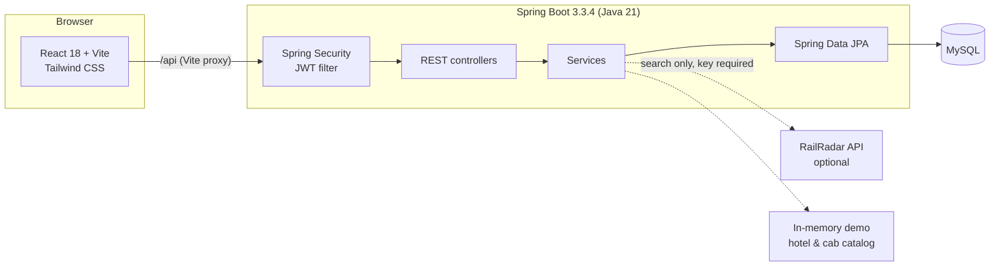

# RailAssist AI — TrainConcierge

A full-stack rail travel assistant built with Spring Boot and React. Passengers can search trains, book and cancel seats, rebook after a disruption, request seat-availability alerts, and add hotel or cab reservations to a journey. Admins manage trains, simulate delays or cancellations, and view booking activity.

> **Naming:** the portfolio project is called **RailAssist AI**; this GitHub repository is named **Train-Concierge**. The current implementation is a rule-based prototype — no ML model or autonomous agent ships in this repository (see [Known limitations](#known-limitations)).

**Stack:** Java 21 · Spring Boot 3.3.4 · Spring Security + JWT · MySQL · React 18 · Vite · Tailwind CSS

---

## Problem

Indian rail passengers juggle several disconnected tasks when a journey is disrupted: checking alternatives, cancelling or rebooking, finding a hotel, arranging a cab, and keeping track of updates. TrainConcierge explores how those steps can live in one authenticated workflow, with a single source of truth for the booking and notifications when a train is delayed or cancelled.

## Features

### Passenger

- Register and sign in; JWT-protected routes with passenger/admin roles.
- Search trains by source, destination, travel date, and seat count.
- Book seats and cancel a booking (seat inventory is updated transactionally).
- Rebook onto an alternative train; the original booking is marked as rebooked and seats are moved.
- View alternatives for a train.
- Create seat-availability alerts for a route and date; cancel them.
- View notifications (delay, cancellation, alternative suggestion, seats available) with unread counts.
- Browse a simulated hotel and cab catalog, reserve against a booking, and cancel reservations.
- Advance a simulated cab ride through `DRIVER_ASSIGNED → EN_ROUTE → ARRIVED → IN_PROGRESS → COMPLETED`.

### Admin

- Create, update, and delete trains.
- Simulate a `DELAY` or `CANCEL` disruption for a train; affected passengers receive notifications and, for cancellations, an alternative-train suggestion.
- Reset a simulated disruption.
- View aggregate stats (users, trains, bookings) and all bookings.

### Data provider

- Uses the seeded MySQL database by default.
- If `RAILRADAR_API_KEY` is set, search results from the optional [RailRadar](https://railradar.in/docs) provider are merged after local, bookable results. Provider failures fall back to database results when available.

## Architecture



- The React app calls `/api`; Vite proxies it to `http://localhost:8080` in development.
- Spring Security is stateless: the JWT filter authenticates each request, `/api/auth/**` and train search/detail are public, `/api/admin/**` requires `ADMIN`, and everything else requires a valid token.
- Hibernate creates/updates the schema on startup (`ddl-auto=update`). There are no migration files yet.
- Hotel and cab inventory are demo catalogs, not external booking providers.

## Repository structure

```text
Train-Concierge/
├── trainconcierge-backend/
│   ├── src/main/java/com/trainconcierge/
│   │   ├── config/          # security, CORS, seed data, exception handling
│   │   ├── controller/      # auth, trains, bookings, hotels/cabs, alerts, admin
│   │   ├── dto/             # request/response records
│   │   ├── entity/          # JPA entities
│   │   ├── provider/        # database and RailRadar train providers
│   │   ├── repository/      # Spring Data repositories
│   │   ├── security/        # JWT filter and utility
│   │   └── service/         # business logic
│   ├── src/main/resources/application.properties
│   ├── src/test/            # provider and service tests (H2)
│   ├── Dockerfile
│   └── pom.xml
├── trainconcierge-frontend/
│   ├── src/
│   │   ├── components/      # shared UI and rebook modal
│   │   ├── context/         # auth state
│   │   ├── layouts/         # navbar and protected routes
│   │   ├── pages/           # passenger and admin screens
│   │   └── services/api.js  # axios client + JWT interceptor
│   ├── vite.config.js
│   └── package.json
├── FRONTEND_API_CONTRACT.md
├── PROTOTYPE_TEST_REPORT.md
└── .env.example
```

## Prerequisites

- JDK 21
- Maven 3.9+
- Node.js 18+ and npm
- MySQL 8+

> The backend requires a reachable MySQL instance. Tests use in-memory H2 and do not need MySQL.

## Setup (Windows PowerShell)

### 1. Create the database

```powershell
mysql -u root -p -e "CREATE DATABASE IF NOT EXISTS trainconcierge;"
```

The JDBC URL also sets `createDatabaseIfNotExist=true`, but the database user must exist and have privileges.

### 2. Configure environment variables

`.env.example` is a reference template — Spring Boot does **not** read `.env` automatically. Export the values in the shell that starts the backend (or set them in your IDE run configuration).

```powershell
$env:DB_URL="jdbc:mysql://localhost:3306/trainconcierge?createDatabaseIfNotExist=true&useSSL=false&allowPublicKeyRetrieval=true"
$env:DB_USERNAME="root"
$env:DB_PASSWORD="your-mysql-password"
$env:JWT_SECRET="a-long-random-string-used-to-sign-tokens"
```

`RAILRADAR_API_KEY` and `CORS_ALLOWED_ORIGINS` are optional.

### 3. Start the backend

```powershell
cd trainconcierge-backend
mvn spring-boot:run
```

The API starts on `http://localhost:8080`.

### 4. Start the frontend

In a second terminal:

```powershell
cd trainconcierge-frontend
npm install
npm run dev
```

Open `http://localhost:5173`.

### 5. Demo accounts

`DataSeeder` creates these accounts on first startup when they do not already exist:

| Role | Username | Password |
| --- | --- | --- |
| Admin | `admin` | `admin123` |
| Passenger | `passenger1` | `pass123` |
| Passenger | `passenger2` | `pass123` |

These credentials exist only for local demonstration. Change or remove the seeder before exposing the application publicly. Public registration always creates a `PASSENGER`; admin accounts are not self-assignable.

## Configuration

| Variable | Default | Purpose |
| --- | --- | --- |
| `DB_URL` | `jdbc:mysql://localhost:3306/trainconcierge?...` | JDBC connection URL |
| `DB_USERNAME` | `root` | MySQL user |
| `DB_PASSWORD` | empty | MySQL password |
| `JWT_SECRET` | dev-only placeholder | HMAC signing secret; set a long random value outside local development |
| `CORS_ALLOWED_ORIGINS` | `http://localhost:5173` | Comma-separated allowed browser origins |
| `RAILRADAR_API_KEY` | empty | Optional RailRadar provider key; empty = database only |

## API overview

All responses use the envelope `{ "success": boolean, "message": string?, "data": T?, "error": string? }`. Protected endpoints require `Authorization: Bearer <token>`.

| Method | Endpoint | Access | Purpose |
| --- | --- | --- | --- |
| POST | `/api/auth/register` | Public | Create a passenger account |
| POST | `/api/auth/login` | Public | Obtain a JWT |
| GET | `/api/trains/search?from=&to=&date=&seats=` | Public | Search trains (`date` = `YYYY-MM-DD`, `seats` 1–10) |
| GET | `/api/trains/{id}` | Public | Train details |
| GET | `/api/trains/{id}/alternatives` | Authenticated | Alternative trains for the same route/date |
| GET | `/api/trains` | Admin | List all trains |
| POST | `/api/bookings` | Authenticated | Create a booking (`trainId`, `numberOfSeats`) |
| GET | `/api/bookings` | Authenticated | Current user's bookings |
| GET | `/api/bookings/{id}` | Authenticated | Booking owned by the current user |
| PATCH | `/api/bookings/{id}/cancel` | Authenticated | Cancel and release seats |
| POST | `/api/bookings/rebook` | Authenticated | Move a booking to another train |
| POST | `/api/seat-alerts` | Authenticated | Create a seat alert (`fromStation`, `toStation`, `travelDate`, `seatsRequired`) |
| GET | `/api/seat-alerts` | Authenticated | Current user's alerts |
| DELETE | `/api/seat-alerts/{id}` | Authenticated | Cancel an alert |
| GET | `/api/notifications` | Authenticated | Current user's notifications |
| GET | `/api/notifications/unread-count` | Authenticated | Unread notification count |
| PATCH | `/api/notifications/{id}/read` | Authenticated | Mark one owned notification read |
| PATCH | `/api/notifications/mark-all-read` | Authenticated | Mark all owned notifications read |
| POST | `/api/hotels` | Authenticated | Reserve a hotel against a booking |
| GET | `/api/hotels/search?city=` | Authenticated | Search the demo hotel catalog |
| GET | `/api/hotels` | Authenticated | Current user's hotel reservations |
| GET | `/api/hotels/booking/{bookingId}` | Authenticated | Hotel reservations for a booking |
| DELETE | `/api/hotels/{id}` | Authenticated | Cancel a hotel reservation |
| POST | `/api/cabs` | Authenticated | Reserve a cab against a booking |
| GET | `/api/cabs/search?city=` | Authenticated | Search the demo cab catalog |
| GET | `/api/cabs` | Authenticated | Current user's cab reservations |
| GET | `/api/cabs/booking/{bookingId}` | Authenticated | Cab reservations for a booking |
| PATCH | `/api/cabs/{id}/ride-status` | Authenticated | Advance simulated ride status |
| DELETE | `/api/cabs/{id}` | Authenticated | Cancel a cab reservation |
| POST | `/api/admin/trains` | Admin | Add a train |
| PUT | `/api/admin/trains/{id}` | Admin | Update a train |
| DELETE | `/api/admin/trains/{id}` | Admin | Delete a train |
| POST | `/api/admin/disruptions` | Admin | Simulate `DELAY` or `CANCEL` |
| POST | `/api/admin/disruptions/{trainId}/reset` | Admin | Reset a train's disruption state |
| GET | `/api/admin/stats` | Admin | Aggregate counts |
| GET | `/api/admin/bookings` | Admin | All bookings |

`FRONTEND_API_CONTRACT.md` documents the DTO fields used by the React client.

## Database

- Schema is generated by Hibernate (`spring.jpa.hibernate.ddl-auto=update`); there is no migration tool configured.
- `DataSeeder` inserts demo users and ~20 trains on startup. Future-dated seed trains are left untouched; expired ones are refreshed so local searches keep working.
- Ticket inventory is decremented/incremented in the booking service inside transactions.

## Testing

```powershell
cd trainconcierge-backend
mvn test
```

The suite uses H2 (`src/test/resources/application-test.properties`) and covers the database provider, RailRadar station-code/date handling, and train search merging. Last verified locally: **44 tests, 0 failures** (2026-10-28). Frontend has no automated test suite yet. `PROTOTYPE_TEST_REPORT.md` is a manual prototype report authored during development; rerun the commands yourself rather than treating it as a CI result.

## Docker

A multi-stage backend image is defined in `trainconcierge-backend/Dockerfile`:

```powershell
docker build -t trainconcierge-backend ./trainconcierge-backend
docker run --rm -p 8080:8080 `
  -e DB_URL="jdbc:mysql://host.docker.internal:3306/trainconcierge?useSSL=false&allowPublicKeyRetrieval=true" `
  -e DB_USERNAME=root -e DB_PASSWORD="your-password" `
  -e JWT_SECRET="a-long-random-string" `
  trainconcierge-backend
```

The frontend is currently run with Vite; no production static-hosting configuration is included.

## Known limitations

- **No real ticketing or payment integration.** Bookings are local database records; there is no PNR, payment gateway, or refund flow.
- **Hotels and cabs are simulated catalogs.** Availability and pricing are demo data.
- **Disruptions are admin-triggered and rule-based.** No ML model, live railway feed, or autonomous decision-making is implemented despite the "AI" project name.
- **Seat alerts are evaluated only when created.** There is no scheduled job that re-checks availability and re-fires alerts later.
- **RailRadar is optional and quota-limited.** Without a key, only seeded/local trains are searchable.
- **JWT is stored in `localStorage`** and there is no refresh-token or revocation flow; an XSS bug would expose the token. No rate limiting is configured.
- **Schema management uses `ddl-auto=update`**, not versioned migrations.
- **No production deployment is linked.** The repository does not include a verified live demo URL.
- **Dead code:** `TimetableImportService` / `TimetableSearchService` are present but not exposed by any controller.

## Security notes

- Passwords are hashed with BCrypt; authentication is stateless JWT.
- Authorization is enforced both by URL rules and `@PreAuthorize` for admin-only train listing.
- Public registration cannot choose a role; it always creates a passenger.
- Notification reads are scoped to the authenticated owner.
- Database credentials, JWT secret, and the RailRadar key are read from environment variables. `.env` files and build outputs are ignored.
- Before deploying: set a strong `JWT_SECRET`, replace seeded demo accounts, restrict `CORS_ALLOWED_ORIGINS`, add HTTPS, rate limiting, and consider moving tokens out of `localStorage`.

## Roadmap

1. Add integration tests for auth, booking/rebooking, and disruption notifications (MockMvc + H2).
2. Replace `ddl-auto=update` with Flyway migrations and a production seed strategy.
3. Add a scheduled seat-alert checker and a real-time notification channel.
4. Add OpenAPI documentation and a Postman collection.
5. Add refresh tokens / secure cookie sessions and request rate limiting.
6. Replace the demo hotel/cab catalogs with real provider adapters.
7. Add a verified deployment (backend + static frontend) and link it here.

## License

No license file is currently included. Add one before distributing or accepting external contributions.
