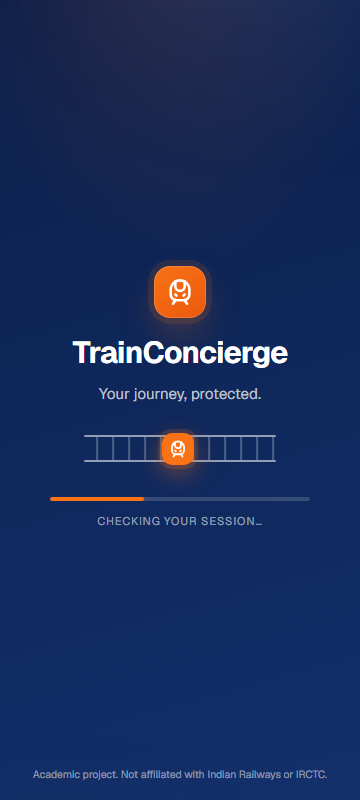
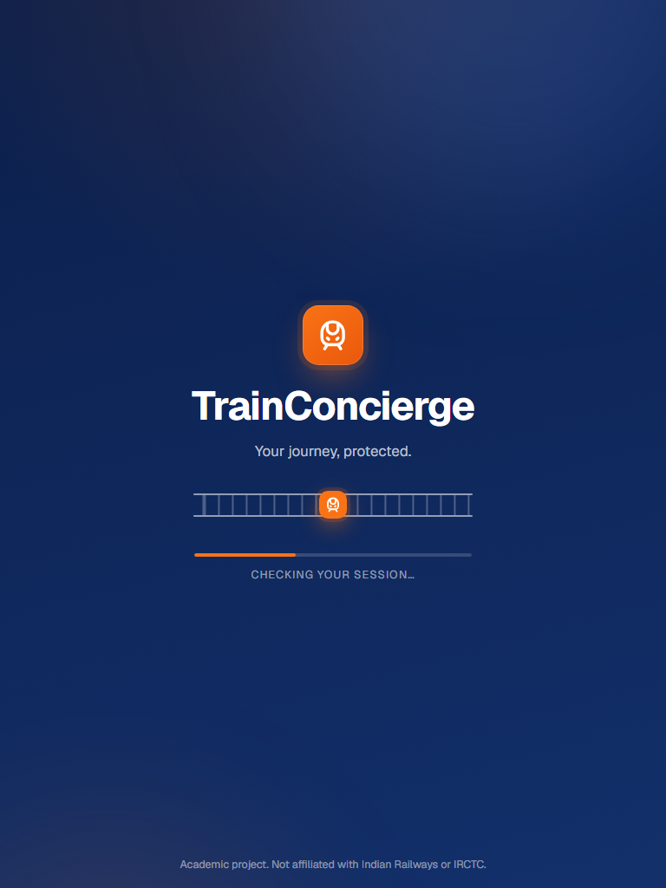
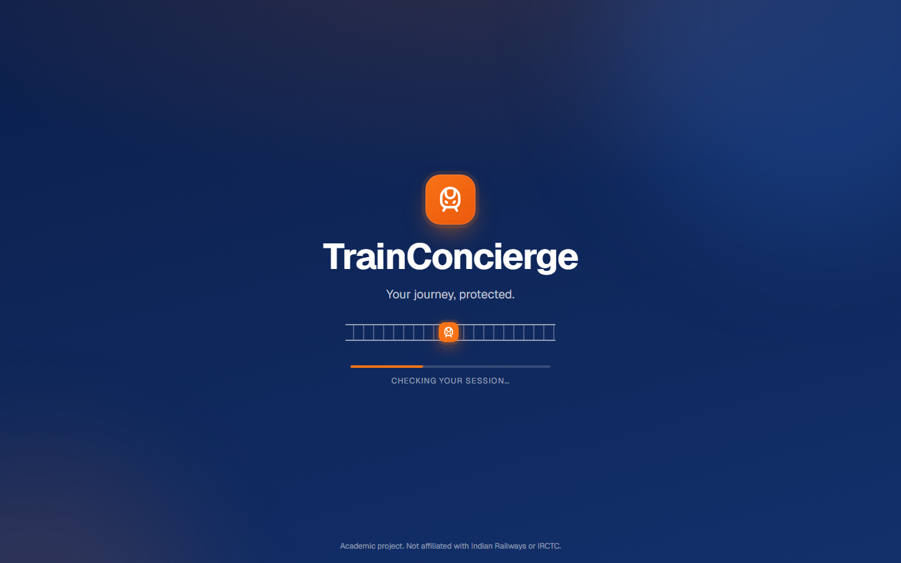
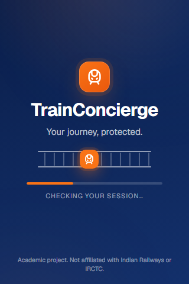
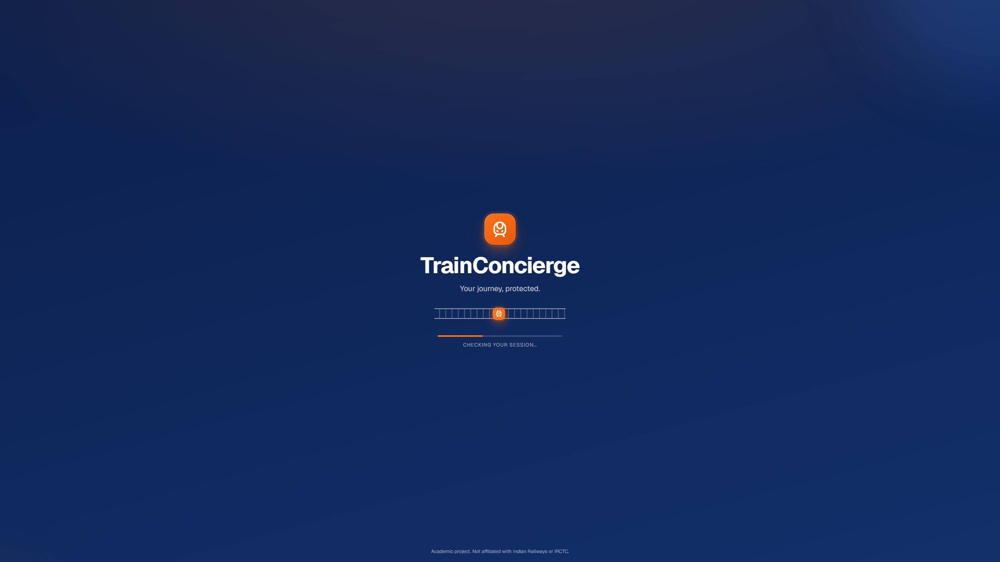
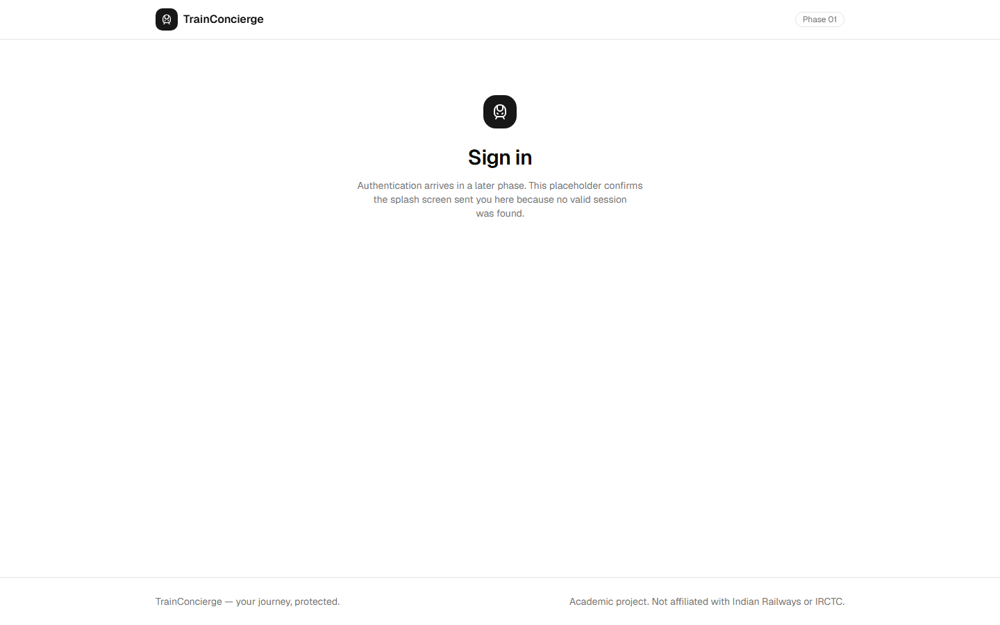

# Phase 01 — Splash Screen and Session Gate

- **Date:** 2026-10-27
- **Branch:** `master`
- **Status:** Complete. The splash, session gate, routing, placeholder destinations, ARIA
  progress bar, reduced-motion handling and 320 px–4K layout are implemented and verified.
  `npm run build` and `npm run test` pass. No backend changes were made.

## 1. What was built

The frontend now opens on a branded full-screen splash at `/` on every fresh page load. It
holds for 4 seconds while a session check runs in parallel, then replaces the current history
entry with the destination for the session:

| Session result | Destination |
| --- | --- |
| No token, invalid/expired token, unknown role, timeout, backend unreachable | `/auth` |
| Valid `PASSENGER` | `/app/dashboard` |
| Valid `ADMIN` | `/admin/dashboard` |

`/auth`, `/app/dashboard` and `/admin/dashboard` are placeholders only. No sign-in flow,
credentials, form or backend auth endpoint was added.

## 2. Implementation

### Files

| File | Purpose |
| --- | --- |
| `frontend/src/features/splash/SplashScreen.tsx` | Full-screen splash markup and ARIA progress bar |
| `frontend/src/features/splash/useSplashGate.ts` | Gate timing, session check, fade state, `replace` navigation |
| `frontend/src/features/splash/TrackAnimation.tsx` | Decorative rail/train animation (`aria-hidden`) |
| `frontend/src/features/splash/splash.css` | Navy gradient, orange accent, responsive and reduced-motion rules |
| `frontend/src/features/splash/__tests__/SplashScreen.test.tsx` | Nine fake-timer tests |
| `frontend/src/app/SessionProvider.tsx` | Session context (`checking`/`authenticated`/`anonymous`) |
| `frontend/src/lib/session.ts` | Token storage key, session types, `SessionGateway`, `fetchCurrentUser()` |
| `frontend/src/lib/storage.ts` | Storage-safe get/set/remove wrappers |
| `frontend/src/lib/time.ts` | `delay()` and `withTimeout()` |
| `frontend/src/features/auth/AuthPage.tsx` | Placeholder `/auth` |
| `frontend/src/features/dashboard/PassengerDashboardPage.tsx` | Placeholder `/app/dashboard` |
| `frontend/src/features/dashboard/AdminDashboardPage.tsx` | Placeholder `/admin/dashboard` |
| `frontend/src/app/router.tsx` | Splash at `/`, layout routes, catch-all to `/auth` |
| `frontend/src/app/App.tsx` | Wraps the router in `SessionProvider` |
| `frontend/src/layouts/RootLayout.tsx` | Shared shell for the placeholder routes (`Phase 01` badge) |
| `frontend/src/test/setup.ts` | Explicit RTL `cleanup()` |

Removed the superseded Phase 00 `HomePage.tsx` and development-only `HealthBadge.tsx`.
`README.md` now describes Phase 01 and the route behaviour.

### Timing model

```ts
const MIN_MS = 4000
const MAX_CHECK_MS = 7000

const check = withTimeout(fetchCurrentUser(), MAX_CHECK_MS, null)
const [, user] = await Promise.all([delay(MIN_MS), check])
```

- The session check starts as soon as the splash mounts; the delay and the check run in
  parallel.
- `withTimeout` resolves `null` at 7 000 ms (or on rejection), so navigation is never later
  than 7 000 ms after the gate starts.
- The 300 ms fade starts at 3 700 ms when the check has already resolved, so it completes at
  the 4 000 ms mark. If the check resolves after that, the fade starts once both the hold and
  the check have completed; a safety timer starts it at 6 700 ms. Navigation follows 300 ms
  after the fade starts, except on the timeout path where it lands at 7 000 ms.
- A module-level gate (`started`/`completed`/`destination`) guarantees one run per page load,
  survives React StrictMode's simulated remount, and immediately `replace`-redirects if `/`
  is mounted again after completion. `__resetSplashGateForTests()` resets it between tests.
- Navigation always uses `{ replace: true }`, so Back does not return to the splash.
- No interaction can skip the splash: it has no buttons or links and scroll is disabled.

### Token handling

- The token is read from `sessionStorage` under `trainconcierge.token` only inside
  `frontend/src/lib/session.ts` (`readToken`) and held by `SessionProvider`. It is never
  logged, rendered, or included in any UI output.
- `fetchCurrentUser()` makes no request when no token exists. With a token it calls
  `GET /api/auth/me` with a bearer header and returns `null` on any failure.
- An invalid session calls `finishSession(null)`, which removes the token before routing to
  `/auth`.
- No official Indian Railways or IRCTC logo or imagery is used. The mark is the Lucide
  `TrainFront` icon; the disclaimer is plain text.

## 3. Live verification

The frontend was served with Vite on port 5174 (5173 was occupied by an unrelated app).
Screenshots and measurements were taken in headless Chrome through the DevTools protocol
with exact device-metrics overrides.

### Timing and routing (anonymous, 1440×900)

| Checkpoint | Observed |
| --- | --- |
| 1 600 ms | `/`, splash visible, progress 38%, no fade |
| 3 750 ms | `/`, splash visible, opacity 1, progress 92%, still `CHECKING YOUR SESSION…` |
| ~3 900 ms | `splash--fading` applied, opacity 0.334, label `WELCOME ABOARD`, progress 96% |
| Route replace | `at = 4083 ms` from document start, URL `/auth` |
| After hold | `/auth`, splash removed from the DOM |
| Console | 0 uncaught exceptions |
| `GET /auth/me` | 0 requests for an anonymous load |

The 4 083 ms figure includes app startup before the gate starts; the gate delay itself is
4 000 ms. The fade completes at the moment of navigation.

### Reduced motion

With `prefers-reduced-motion: reduce` emulated:

- Rail sleeper animation: `none`.
- Train animation: `none` (mark shown stationary at the centre).
- Progress bar remains present and updates.
- Route replace still occurred at `4 205 ms` from document start → `/auth`.

The hold is driven by timers, not by CSS animation, so motion preference cannot shorten it.

### Responsive layout

No horizontal or vertical overflow at any tested size:

| Viewport | `scrollWidth × scrollHeight` | Wordmark bounds | Footer bounds | Progress |
| --- | --- | --- | --- | --- |
| 320 × 480 | 320 × 480 | 52–268 | 20–300 | 36% |
| 360 × 800 | 360 × 800 | 72–288 | 20–340 | 38% |
| 768 × 1024 | 768 × 1024 | 221–547 | 20–748 | 39% |
| 1440 × 900 | 1440 × 900 | 516–924 | 20–1420 | 38% |
| 2560 × 1440 | 2560 × 1440 | 1076–1484 | 20–2540 | 38% |

`documentElement.scrollWidth/scrollHeight` always equal the viewport, so the splash does not
scroll. Minimum supported width is 320 px; the 4K spot-check used 2560×1440.

### Screenshots

**360 × 800**



**768 × 1024**



**1440 × 900**



**Extra checks — 320 × 480 and 2560 × 1440**





**Post-gate destination (anonymous)**



## 4. Tests

`npm run test` — **PASS**, 2 files, 11 tests (9 splash + 2 existing utility tests):

```text
 ✓ src/lib/utils.test.ts (2 tests)
 ✓ src/features/splash/__tests__/SplashScreen.test.tsx (9 tests)

 Test Files  2 passed (2)
      Tests  11 passed (11)
```

Splash coverage:

1. No navigation at 3 999 ms; anonymous navigation to `/auth` at 4 000 ms.
2. Valid `PASSENGER` → `/app/dashboard`.
3. Valid `ADMIN` → `/admin/dashboard`.
4. Invalid token is cleared and the route becomes `/auth`.
5. A session check that never resolves still leaves the splash at 7 000 ms.
6. Progress bar exposes `role="progressbar"`, `aria-valuemin=0`, `aria-valuemax=100`, a
   numeric `aria-valuenow`, an accessible name, and the value advances.
7. StrictMode starts exactly one gate: one 4 000 ms timer, one 7 000 ms cap and one call to
   `fetchCurrentUser`.
8. In-app route changes do not replay the splash.
9. Back navigation after the gate does not return to the splash.

## 5. Acceptance criteria

| Criterion | Result | Evidence |
| --- | --- | --- |
| 4 s splash while the session check runs in parallel | **PASS** | `Promise.all([delay(4000), withTimeout(check, 7000)])`; replace at 4 083 ms document time |
| No/invalid token → `/auth` | **PASS** | Live anonymous run + tests 1 and 4 |
| Valid token → role home | **PASS** | Tests 2 and 3 with a stubbed gateway |
| Invalid token cleared → `/auth` | **PASS** | Test 4 asserts the stored token is `null` afterwards |
| Slow/failing backend never exceeds 7 s | **PASS** | Test 5: still on splash at 6 999 ms, at `/auth` on 7 000 ms |
| No flash of another page before the splash ends | **PASS** | Test 1 and live snapshot at 3 999/3 750 ms |
| Back does not return to the splash | **PASS** | `replace` navigation + test 9 |
| Reduced motion: no movement, same duration | **PASS** | CDP: animations `none`, route at 4 205 ms |
| Layout at 360/768/1440 px | **PASS** | Screenshots and no-overflow measurements |
| `npm run build` / `npm run test` | **PASS** | 2 060 modules; 11 tests |

Additional requirements: token never logged or printed (no `console` calls in `src`; token
access confined to `lib/session.ts`); no official railway imagery; no real sign-in; no
commit or push.

## 6. Build and lint

```text
npm run build
✓ 2060 modules transformed
dist/assets/index-*.css   30.53 kB │ gzip: 6.74 kB
dist/assets/index-*.js   397.48 kB │ gzip: 127.34 kB
✓ built in 910 ms

npm run lint
Found 2 warnings and 0 errors.
```

Both warnings are the Fast Refresh “file exports non-components” rule: the shadcn
`button.tsx` variant export (generated) and `useSession` exported beside the provider
(standard context pattern). Neither affects behaviour or the build.

## 7. Known limits and follow-ups

- **No `/api/auth/me` yet.** Live verification covers the anonymous path; `PASSENGER` and
  `ADMIN` routing are verified with a stubbed `fetchCurrentUser`. A present but invalid token
  currently produces a failing request and then `/auth`.
- **Unreachable backend and invalid token are treated the same.** Both return `null` and
  clear the stored token. When real auth lands, consider preserving the token on transient
  network errors.
- **Fade nuance with a slow check.** The normal path fades from 3 700–4 000 ms. If the check
  resolves between 3 700 and 4 000 ms, the fade is deferred to 4 000 ms and navigation lands
  at 4 300 ms; if it resolves between 4 000 and 6 700 ms, the fade starts on resolution and
  navigation follows 300 ms later; the timeout path fades 6 700–7 000 ms. The splash
  therefore lasts longer than 4 s only when the backend is slow, and never exceeds 7 s.
- **Placeholder routes are unguarded.** Deep-linking to `/app/dashboard` renders the
  placeholder without a session. Route guards belong to the authentication phase.
- **Dev HMR** preserves the module gate until a full reload; a fresh page load always starts
  a new 4 s hold.
- `/` is a real route that redirects to the last destination after completion, rather than
  re-showing the splash. There is no user-facing way to replay it without a reload.
- Screenshots were produced headlessly through CDP; 4K was spot-checked at 2560×1440.
