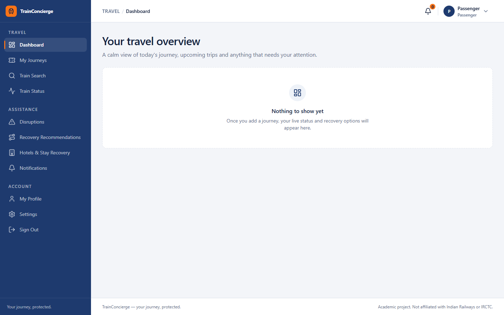
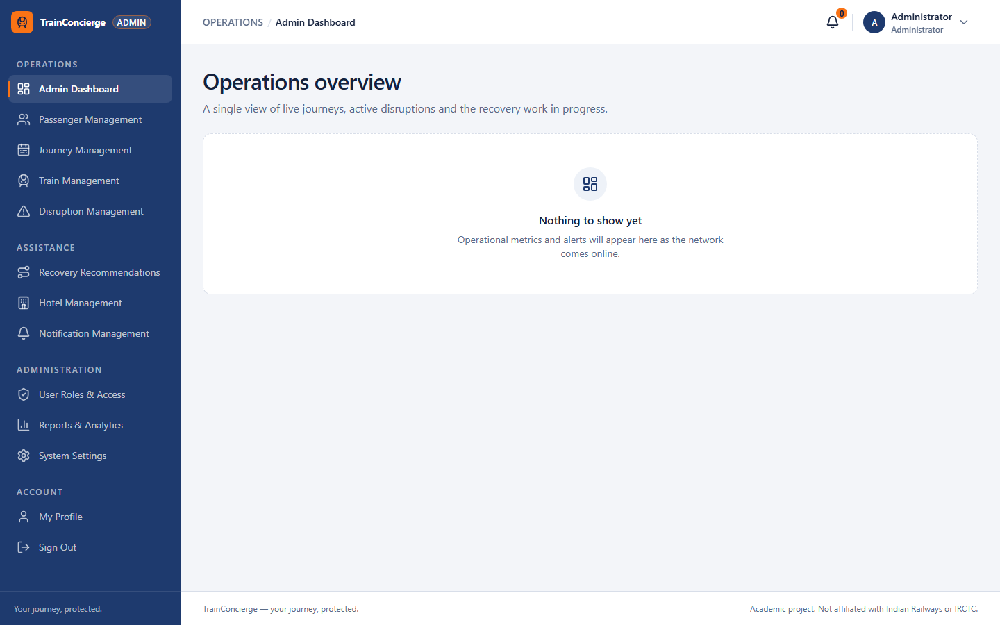
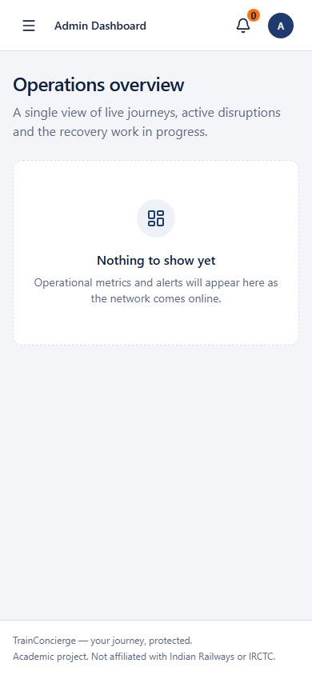
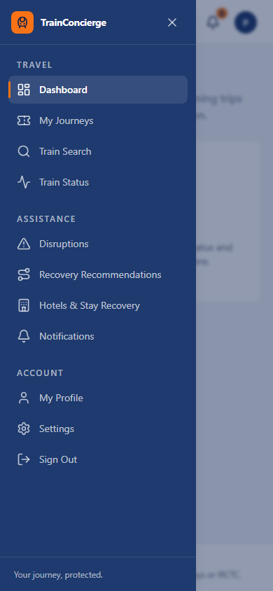
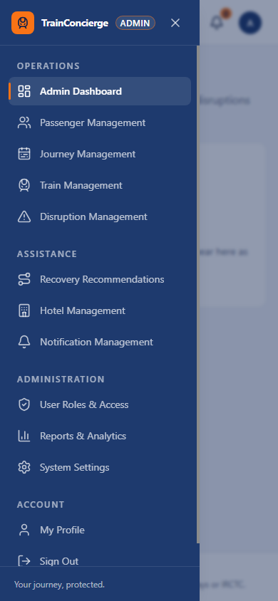
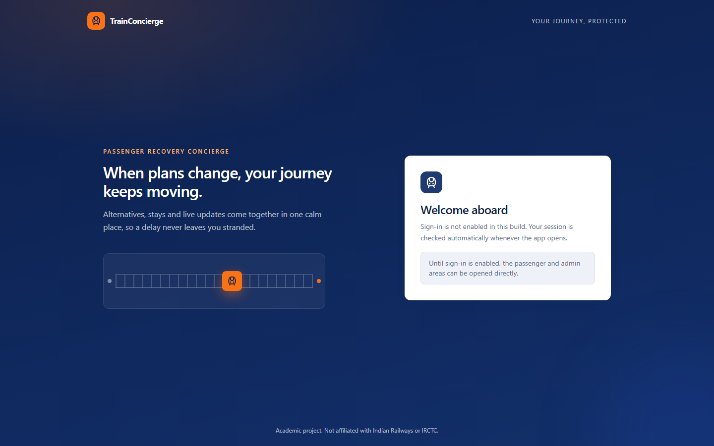
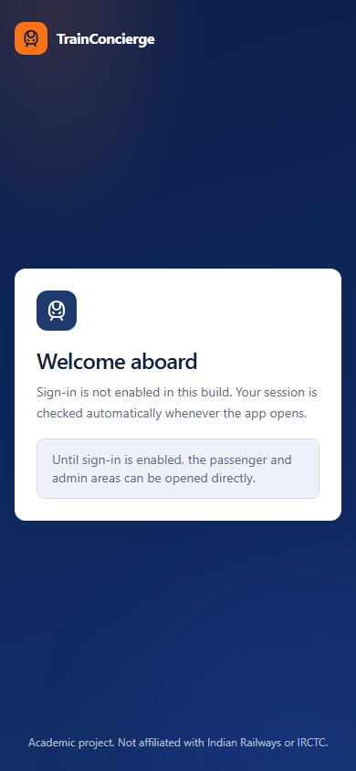

# Phase 02 — Design System and Application Shells

- **Date:** 2026-10-27
- **Branch:** `master`
- **Status:** Complete. The token-based design system, shared component library, auth layout and
  passenger/admin shells with data-driven sidebars are implemented and verified. Every sidebar
  route has a placeholder page, plus a 404. `npm run build`, `npm run test` and `npm run lint`
  pass. No backend changes were made, no dependencies were added, and nothing was committed or
  pushed.

## 1. What was built

- **Design tokens** in `frontend/src/styles/tokens.css`, mapped into Tailwind with
  `@theme inline` in `frontend/src/styles/index.css`. The exact brand palette is used, with a
  single type family (system UI) and one card elevation.
- **UI primitives** in `frontend/src/components/ui/`: Button, Input, Select, Checkbox,
  DatePicker, Card, Badge, Tabs, Dialog, Sheet, Toast, Tooltip and Skeleton.
- **Shared components** in `frontend/src/components/`: StatusBadge, PageHeader, EmptyState,
  ErrorState, StatCard, DataTable, ConfirmDialog, AvailabilityLegend, BrandMark and
  PlaceholderPage.
- **Layouts** in `frontend/src/layouts/`: `AuthLayout`, `PassengerLayout`, `AdminLayout`, and a
  shared `AppShell` with a fixed 260 px navy sidebar at ≥1024 px, a 280 px Sheet drawer below
  that, a sticky header, a notification bell with a static 0 badge and a profile menu.
- **Navigation data** in `frontend/src/layouts/nav.ts`: exact groups, items, order, icons and
  routes for both roles. The shells render this data; they do not hard-code links.
- **22 placeholder routes** across the passenger and admin areas, each with a unique page
  title, an EmptyState and deliberately neutral copy. Plus `/auth` and a 404.
- **`<DisruptionModalHost />`** mounted empty in the passenger layout, returning `null` until a
  later phase adds disruption modals.

No real sign-in, feature data, API calls or feature screens were added. `/auth` remains a
placeholder that explains sign-in is not enabled, and both shells can be opened directly by
URL.

## 2. Design tokens

### Colour

Defined once in `frontend/src/styles/tokens.css` and consumed through Tailwind utilities such
as `bg-brand-navy`, `text-muted`, `border-border` and `bg-page`.

| Token | Value | Use |
| --- | --- | --- |
| `--brand-navy` | `#1E3A6E` | Primary buttons, sidebar, focus ring, active tabs |
| `--brand-navy-dark` | `#0B1F4B` | Auth gradient depth, text on orange |
| `--accent-orange` | `#F97316` | CTA buttons and the active navigation indicator |
| `--accent-orange-soft` | `#FDBA74` | Small orange text on navy (contrast-safe) |
| `--surface` | `#FFFFFF` | Cards, header, inputs, popovers |
| `--page` | `#F3F5F9` | Page background |
| `--surface-muted` | `#EEF2F8` | Secondary fills and hover states |
| `--border` | `#D8DEE9` | Card and control borders |
| `--text` | `#14213D` | Primary text |
| `--muted` | `#5B6B87` | Secondary text |
| `--success` / soft | `#166534` / `#DCFCE7` | Success badge text / background |
| `--warning` / soft | `#92400E` / `#FEF3C7` | Warning badge text / background |
| `--danger` / soft | `#B91C1C` / `#FEE2E2` | Danger badge text / background |
| `--info` / soft | `#1E40AF` / `#DBEAFE` | Info badge text / background |
| `--neutral` / soft | `#334155` / `#E2E8F0` | Neutral badge text / background |

`text-muted` maps to the text token, not to the muted surface; this distinction was corrected
during verification after descriptions initially rendered nearly invisible.

### Type, geometry and elevation

| Property | Implementation |
| --- | --- |
| Font family | One family: `--font-ui` system stack (`system-ui`, `-apple-system`, `Segoe UI`, Roboto, Helvetica Neue, Arial). No webfont request. |
| Type sizes | 12, 14, 16, 20, 24 and 32 px (`text-xs` → `PageHeader`'s 32 px h1) |
| Control height | 40 px (`h-10`) for buttons, inputs, selects and date pickers |
| Control icons | 18 px |
| Navigation icons | 20 px |
| Radius | 8 px controls (`rounded-lg`), 12 px cards and dialogs (`rounded-xl`, `--radius-xl: 0.75rem`) |
| Elevation | One token, `--elevation-card: 0 1px 2px rgb(20 33 61 / 0.06), 0 8px 24px -12px rgb(20 33 61 / 0.18)`, exposed as `shadow-card` |
| Motion | Short colour/opacity transitions only; a global `prefers-reduced-motion: reduce` rule disables animation and smooth scrolling |

Dark mode was optional in the brief and was not implemented; the system ships with the light
theme only.

## 3. Shared component inventory

### Primitives — `frontend/src/components/ui/`

| Component | Key behaviour |
| --- | --- |
| `button.tsx` | Variants `default` (navy), `cta` (orange with navy-dark text), `outline`, `secondary`, `ghost`, `destructive`, `link`; sizes default 40 px, sm 36 px, lg 44 px, icon 40 px; 18 px icons; `asChild` support; visible focus ring |
| `input.tsx` | Accessible label, hint and error wiring with `useId`; `aria-invalid`, `aria-describedby`; 40 px height |
| `select.tsx` | Radix Select with label, description, error, portal content, check indicator and 40 px trigger |
| `checkbox.tsx` | Radix Checkbox with 18 px box, label, description and focus ring |
| `date-picker.tsx` | Native date input with label, hint/error wiring and a calendar icon |
| `card.tsx` | White 12 px-radius surface with `shadow-card`; Header, Title, Description, Content and Footer |
| `badge.tsx` | Tones neutral, success, warning, danger, info, outline; rounded-full, 12 px text; `data-tone` hook |
| `tabs.tsx` | Radix Tabs with a segmented 40 px list; the active tab is a white surface with navy text |
| `dialog.tsx` | Radix Dialog, navy-tinted blurred overlay, 12 px white panel, title 20 px, close button, Header/Footer |
| `sheet.tsx` | Radix Dialog in sheet form, left/right slide, accessible hidden title, used for the mobile navigation drawer |
| `toast.tsx` | Radix Toast provider and `useToast()` for info/success/danger messages, bottom-right viewport |
| `tooltip.tsx` | Radix Tooltip and provider, mounted once in `AppProviders` |
| `skeleton.tsx` | Pulse placeholder on the muted surface |

### App-level components — `frontend/src/components/`

| Component | Key behaviour |
| --- | --- |
| `StatusBadge.tsx` | Maps a status string to a tone and human label, renders a dot plus the text, exposes `data-status`; accepts a `label` override; colour is never the only signal |
| `PageHeader.tsx` | Single page `h1` at 24/32 px with description and optional eyebrow/actions |
| `EmptyState.tsx` | Dashed card, icon, default title “Nothing to show yet”, description and optional action |
| `ErrorState.tsx` | `role="alert"` message with a retry action |
| `StatCard.tsx` | KPI card with label, value, supporting text and icon |
| `DataTable.tsx` | Generic table with screen-reader caption and column scopes; below 640 px the same rows render as stacked, labelled cards |
| `ConfirmDialog.tsx` | Confirmation dialog with destructive and cancel actions |
| `AvailabilityLegend.tsx` | Available / Limited / Sold out legend using the same status tones |
| `BrandMark.tsx` | Orange `TrainFront` mark and wordmark; `onDark` and `admin` variants; no railway or IRCTC imagery |
| `PlaceholderPage.tsx` | Composes PageHeader and EmptyState for the 22 placeholder routes |

### Status vocabulary

`frontend/src/lib/status.ts` defines **31 statuses**, covering every status named in the README:

| Area | Statuses |
| --- | --- |
| Train and journey | `ON_TIME`, `DELAYED`, `DIVERTED`, `RESCHEDULED`, `CANCELLED`, `COMPLETED`, `UPCOMING`, `ACTIVE` |
| Booking | `CONFIRMED`, `WAITLISTED`, `RAC`, `PENDING`, `REFUNDED`, `FAILED` |
| Disruption | `OPEN`, `MONITORING`, `RESOLVED`, `CLOSED` |
| Recovery recommendation | `NEW`, `ACCEPTED`, `DECLINED`, `EXPIRED` |
| Availability | `AVAILABLE`, `LIMITED`, `SOLD_OUT`, `BOOKED` |
| Notification | `UNREAD`, `READ` |
| Account | `INACTIVE`, `SUSPENDED` |
| Payment | `PAID` |

Unknown values fall back to a neutral badge with a humanized label (for example
`PARTIALLY_DELAYED` → “Partially delayed”), so a new backend status degrades safely rather than
disappearing.

## 4. Layouts and navigation

### Auth layout — `/auth`

Navy gradient page with a soft orange glow, the brand mark top-left, a supporting line on the
right and a white card containing the outlet. At ≥1024 px a hero panel adds a 32 px headline,
supporting copy and a static, decorative track illustration (`aria-hidden`). Below that the
card is the only content, centred at up to 28 rem. The page itself states that sign-in is not
enabled and that the passenger and admin areas can be opened directly.

### Passenger and admin shells

Both roles share `AppShell`:

- **Desktop (≥1024 px):** fixed 260 px navy sidebar, `lg:pl-[260px]` content offset.
- **Below 1024 px:** the sidebar is hidden and a menu button labelled “Open navigation” opens a
  280 px left Sheet drawer. The drawer has an accessible title, a visible close button, and
  closes after navigating.
- **Header:** 64 px sticky white bar with the mobile menu button, a breadcrumb (`<p>`, so there
  is only one `h1` per page), the notification bell and the profile menu.
- **Notification bell:** link to the notifications route, `aria-label="Notifications, 0 unread"`,
  static 0 badge with an orange ring against the header surface. It performs no fetching.
- **Profile menu:** initials avatar; name and role from the session, falling back to
  “Passenger” / “Administrator”; My Profile, Settings and Sign Out. Sign Out calls
  `finishSession(null)` and replaces the route with `/auth`.
- **Body:** page background `--page`, content constrained to `max-w-6xl`, footer with the
  academic/non-affiliation disclaimer.
- **Admin:** the logo carries a bordered “Admin” tag beside the wordmark.
- **Passenger only:** `<DisruptionModalHost />` is mounted and currently returns `null`.

`Sidebar` renders the navy surface, brand link, group labels at 12 px in white/60, 40 px links,
20 px icons and an optional sign-out button. The active link has a 3 px orange indicator, a
`bg-white/10` surface, `aria-current="page"` and `data-active="true"`; inactive links have
`data-active="false"` and no `aria-current`.

### Exact navigation

**Passenger** (`Passenger navigation`):

| Group | Items in order |
| --- | --- |
| TRAVEL | Dashboard, My Journeys, Train Search, Train Status |
| ASSISTANCE | Disruptions, Recovery Recommendations, Hotels & Stay Recovery, Notifications |
| ACCOUNT | My Profile, Settings, Sign Out |

**Admin** (`Admin navigation`):

| Group | Items in order |
| --- | --- |
| OPERATIONS | Admin Dashboard, Passenger Management, Journey Management, Train Management, Disruption Management |
| ASSISTANCE | Recovery Recommendations, Hotel Management, Notification Management |
| ADMINISTRATION | User Roles & Access, Reports & Analytics, System Settings |
| ACCOUNT | My Profile, Sign Out |

Routes are declared in `frontend/src/layouts/nav.ts`; `/app` and `/admin` index redirects go to
their dashboards.

## 5. Routes and placeholder pages

Every sidebar destination renders `PlaceholderPage` (PageHeader + EmptyState) with a unique
title that is not the sidebar label repeated, and with product copy free of developer or
phase wording. The empty title is always “Nothing to show yet”; the description is specific to
the page.

| Route | Page heading |
| --- | --- |
| `/app/dashboard` | Your travel overview |
| `/app/journeys` | Your journeys |
| `/app/search` | Find a train |
| `/app/status` | Live train status |
| `/app/disruptions` | Disruption updates |
| `/app/recovery` | Recovery options |
| `/app/hotels` | Stay recovery |
| `/app/notifications` | Your notifications |
| `/app/profile` | Profile details |
| `/app/settings` | Account settings |
| `/admin/dashboard` | Operations overview |
| `/admin/passengers` | Passenger directory |
| `/admin/journeys` | Journey records |
| `/admin/trains` | Train catalogue |
| `/admin/disruptions` | Disruption desk |
| `/admin/recommendations` | Recommendation review |
| `/admin/hotels` | Hotel partners |
| `/admin/notifications` | Notification delivery |
| `/admin/roles` | Roles and access |
| `/admin/reports` | Reports and analytics |
| `/admin/settings` | System configuration |
| `/admin/profile` | Administrator profile |

Unknown URLs render `NotFoundPage` (“Page not found”) with a link to `/auth`. `/` remains the
Phase 01 splash and session gate; `/app` and `/admin` redirect to their dashboards. Deep links
to shell routes are intentionally unguarded until authentication lands.

## 6. Accessibility and contrast

- **Visible focus:** every `a`, `button`, `input`, `select`, `textarea` and tabbable element has
  a 2 px navy outline with a 2 px offset. Keyboard probing confirmed a navy
  `rgb(27, 50, 95)` 2 px outline on header buttons and an orange 2 px outline on sidebar links
  (orange is the focus colour on navy).
- **Labels:** Input, Select, Checkbox and DatePicker generate ids with `useId`, link labels,
  descriptions and errors, and set `aria-invalid` / `aria-describedby` on error.
- **Colour is never the only signal:** StatusBadge renders the textual label and a dot; the
  availability legend pairs each colour with its label; active navigation uses an indicator
  plus `aria-current`, not colour alone.
- **Semantics:** one `h1` per route; navigation landmarks are named “Passenger navigation” and
  “Admin navigation”; DataTable has a caption and `scope="col"` headers, and the mobile version
  uses `<dl>` label/value pairs; the drawer is a labelled dialog with a close button; decorative
  art is `aria-hidden`.
- **Reduced motion:** a global media query reduces animation and transition durations to
  0.01 ms and disables smooth scrolling. The Phase 01 splash timing is timer-driven and
  unaffected.
- **Text contrast:** all tested foreground/background pairs meet or exceed 4.5:1.

| Pair | Ratio |
| --- | --- |
| `--text` on `--page` | 14.63:1 |
| White on `--brand-navy` | 11.14:1 |
| `--muted` on white | 5.39:1 |
| `--muted` on `--page` | 4.94:1 |
| Status text on status-soft backgrounds | 5.30:1 – 8.40:1 |
| `--brand-navy-dark` on `--accent-orange` (CTA) | 5.71:1 |
| `--accent-orange-soft` on `--brand-navy-dark` | 9.49:1 |

## 7. Live verification

The frontend was served with Vite on port 5174 (5173 was occupied by an unrelated app).
Screenshots and measurements were taken in headless Chrome through the DevTools protocol with
exact device-metrics overrides. There were no uncaught console exceptions and no failed runtime
checks.

### Measured geometry and tokens

| Check | Observed |
| --- | --- |
| Control height | 40 px |
| Control radius | 8 px |
| Card radius | 12 px |
| Sidebar width at ≥1024 px | 260 px |
| Drawer width | 280 px in both roles |
| Body text / page `h1` | 16 px / 32 px at desktop |
| System font | `system-ui` stack with no webfont request |
| `--muted` | `rgb(91, 107, 135)` on `rgb(243, 245, 249)` |
| Active navigation | `bg-white/10` plus a 3 px orange indicator |
| Elevation | `0 1px 2px rgb(20 33 61 / 0.06), 0 8px 24px -12px rgb(20 33 61 / 0.18)` |

### Responsive behaviour

`document.documentElement.scrollWidth` equalled the viewport width at every tested size, so
there is no horizontal overflow from 320 px to 2560 px.

| Viewport | Sidebar | Toggle | Drawer | Overflow |
| --- | --- | --- | --- | --- |
| 320 × 480 | Hidden | Visible | 280 px, close visible | None |
| 360 × 800 | Hidden | Visible | 280 px, close visible | None |
| 390 × 844 | Hidden | Visible | 280 px, close visible | None |
| 640 × 900 | Hidden | Visible | 280 px | None |
| 1023 × 900 | `display: none` | `display: flex` | Available | None |
| 1024 × 900 | `display: flex`, 260 px | Hidden | n/a | None |
| 1440 × 900 | `display: flex`, 260 px | Hidden | n/a | None |
| 2560 × 1440 | `display: flex`, 260 px | Hidden | n/a | None |

Both roles were checked at desktop and mobile widths, as was the auth layout. Opening the
drawer showed 10 passenger links (and the sign-out action), a visible close button and no
overflow; selecting a link navigated and closed the drawer.

### Screenshots

**Passenger shell — 1440 × 900**



**Admin shell — 1440 × 900**



**Passenger shell — 390 × 844**


**Admin shell — 390 × 844**



**Passenger navigation drawer — 390 × 844**



**Admin navigation drawer — 390 × 844**



**Auth layout — 1440 × 900 and 390 × 844**





## 8. Tests

`npm run test` — **PASS**, 4 files, 52 tests, 31 snapshots:

```text
 ✓ src/lib/utils.test.ts (2 tests)
 ✓ src/components/__tests__/StatusBadge.test.tsx (33 tests)
 ✓ src/features/splash/__tests__/SplashScreen.test.tsx (9 tests)
 ✓ src/app/__tests__/layouts.test.tsx (8 tests)

 Test Files  4 passed (4)
      Tests  52 passed (52)
```

New Phase 02 coverage:

1. Passenger sidebar renders every group label, link in exact order, and the Sign Out action.
2. Admin sidebar renders all four groups and 12 links in exact order, plus the Admin tag.
3. The current passenger route gets `data-active="true"`, `aria-current="page"` and the exact
   `bg-white/10` class token; other links do not.
4. The current admin route is marked active the same way.
5. The mobile drawer opens from “Open navigation”, contains the full passenger navigation, and
   closes after navigating to Train Search.
6. Each shell renders a single `h1`, and the sidebar label (“Dashboard”) is not repeated as a
   heading.
7. Placeholder pages render “Nothing to show yet”.
8. An unknown path renders the 404 page.

StatusBadge coverage: one snapshot per status (31), unknown fallback to neutral with a
humanized label, and a custom `label` override that preserves the tone. Phase 01 splash tests
(9) and existing utility tests (2) still pass.

## 9. Build and lint

```text
npm run build
✓ 2206 modules transformed
dist/index.html                   0.46 kB │ gzip:   0.30 kB
dist/assets/index-*.css          43.19 kB │ gzip:   9.18 kB
dist/assets/index-*.js          557.24 kB │ gzip: 180.72 kB
(!) Some chunks are larger than 500 kB after minification.
✓ built in 1.17s

npm run lint
Found 4 warnings and 0 errors.
```

The bundle warning is informational; route-level code splitting is a sensible follow-up when
feature screens add weight. The four lint warnings are the Fast Refresh “file also exports
non-components” rule for `buttonVariants`, `badgeVariants`, `useToast`/`ToastInput` and
`useSession`. They follow the standard shadcn/context pattern and do not affect behaviour or
the build.

## 10. Acceptance criteria

| Criterion | Result | Evidence |
| --- | --- | --- |
| Exact brand tokens, statuses, one font, 12/14/16/20/24/32 type scale | **PASS** | `tokens.css` / `index.css`; measured computed styles |
| 40 px controls, 8 px control radius, 12 px card radius, one shadow | **PASS** | Computed geometry and `shadow-card` |
| All listed primitives and shared components exist with states | **PASS** | Component inventory; type-check/build |
| StatusBadge covers every README status plus unknown fallback | **PASS** | 31-entry `STATUS_META`, 33 tests |
| Auth, passenger and admin layouts with exact sidebar groups/order | **PASS** | `nav.ts`; layout tests 1–4 |
| Fixed 260 px sidebar ≥1024 px; Sheet drawer below | **PASS** | 1023/1024 px measurements; drawer test and screenshots |
| Header: toggle, page title area, bell with static 0, profile menu | **PASS** | `Header.tsx`, `NotificationBell.tsx`, `ProfileMenu.tsx` |
| Admin tag beside logo; DisruptionModalHost mounted empty | **PASS** | Screenshot; `DisruptionModalHost.tsx` returns `null` |
| One unique placeholder page per sidebar route, no repeated label, no dev/phase copy | **PASS** | Route/heading table; layout tests 6–7 |
| 404 route | **PASS** | Catch-all; layout test 8 |
| Visible focus, labels, non-colour status cues, 4.5:1 contrast | **PASS** | Keyboard/CDP probes and contrast table |
| Layouts from 320 px to 4K with no overflow | **PASS** | Responsive table; screenshots |
| `npm run build`, `npm run test`, `npm run lint` | **PASS** | 2206 modules; 52 tests; 0 errors |
| No real data, API calls or real authentication | **PASS** | Placeholder pages and static bell/profile data |
| No new libraries; no secrets; no commit or push | **PASS** | `package.json` unchanged; `.env*` ignored; working tree left uncommitted |

## 11. Known limits and next-phase handoff

- **Routes are unguarded.** `/app/*` and `/admin/*` render without a session by design, so the
  shells can be reviewed directly. Route guards belong to the authentication phase and should
  read `SessionProvider` and redirect to `/auth`.
- **No feature data.** Every screen is a PageHeader + EmptyState. The bell is always 0, the
  profile menu falls back to “Passenger” / “Administrator”, and there are no network requests
  from the shells.
- **Sign Out is local only.** It clears the session through `finishSession(null)` and navigates
  to `/auth`; there is no backend logout endpoint yet.
- **Placeholder copy is English-only.** There is no i18n layer, and dates/times are not
  formatted beyond the native date input.
- **Dark mode is not implemented.** It was optional; the tokens are structured so a
  `prefers-color-scheme` or theme class could be added later, but status soft backgrounds would
  need dark variants.
- **Bundle size.** The single JS chunk is 557.24 kB (180.72 kB gzip) and triggers Vite’s
  500 kB warning. Introduce route-level lazy loading when the feature screens land.
- **Fast Refresh warnings.** The four warnings are the standard non-component exports beside
  components. They are harmless; split variant/context exports only if the team wants a clean
  lint output.
- **Next-phase entry points:** replace each `PlaceholderPage` body with the feature screen while
  keeping `PageHeader`; build lists with `DataTable`, `StatusBadge`, `Skeleton`, `EmptyState`
  and `ErrorState`; open dialogs/sheets through the existing primitives; mount disruption
  dialogs inside `DisruptionModalHost`; add or reorder navigation only in `src/layouts/nav.ts`.
- Reviewers can open `/app/dashboard` and `/admin/dashboard` directly, or go through `/` and
  `/auth`. Nothing in this phase was committed or pushed.
