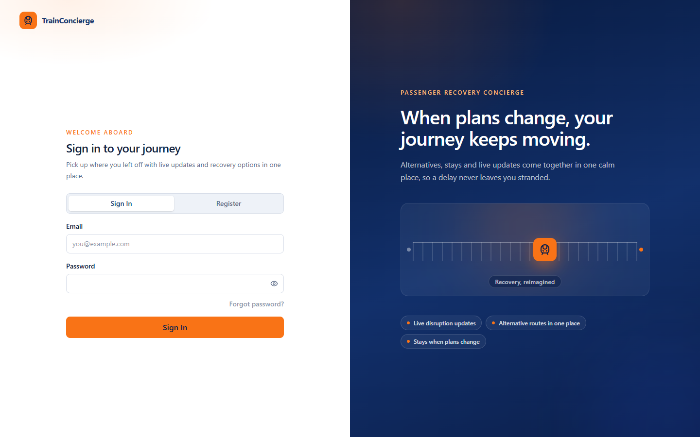
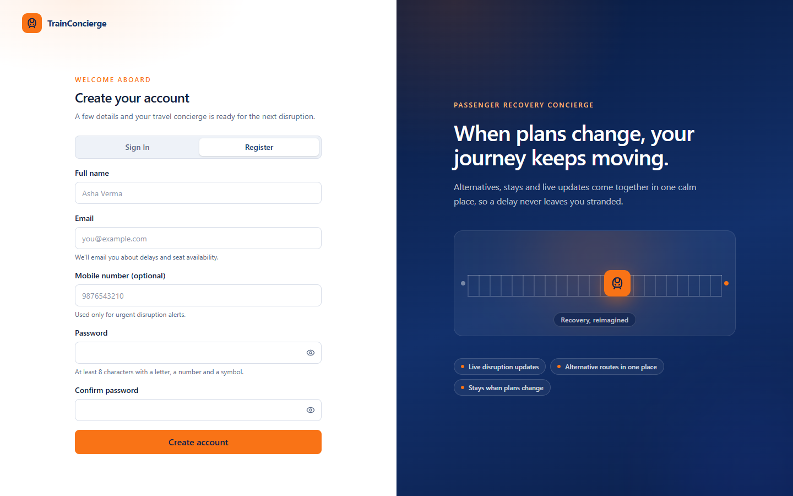
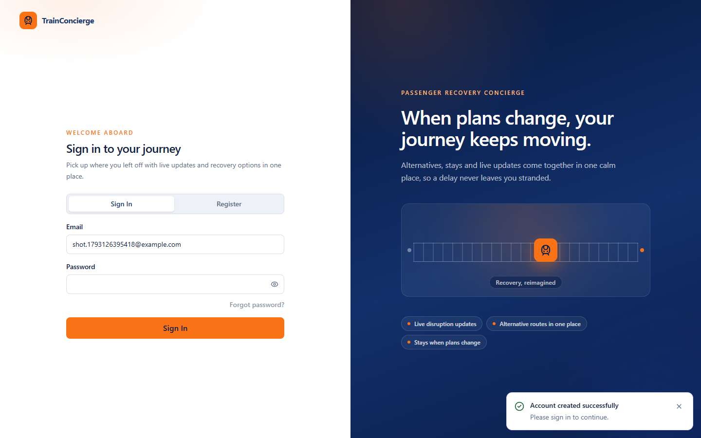
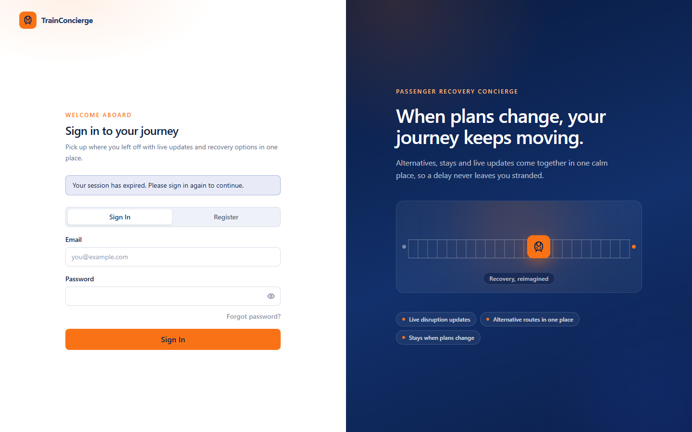
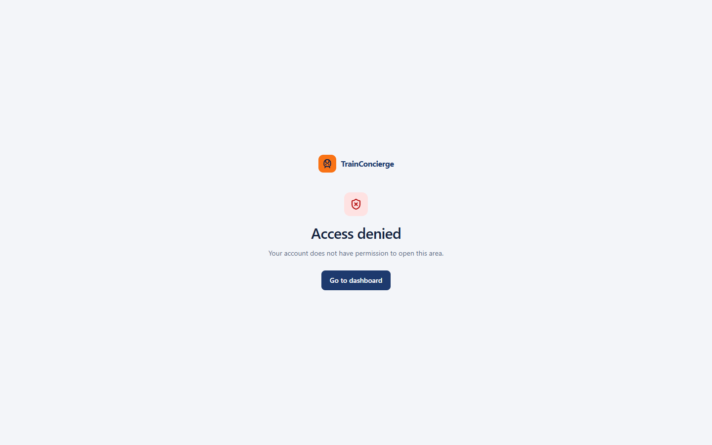
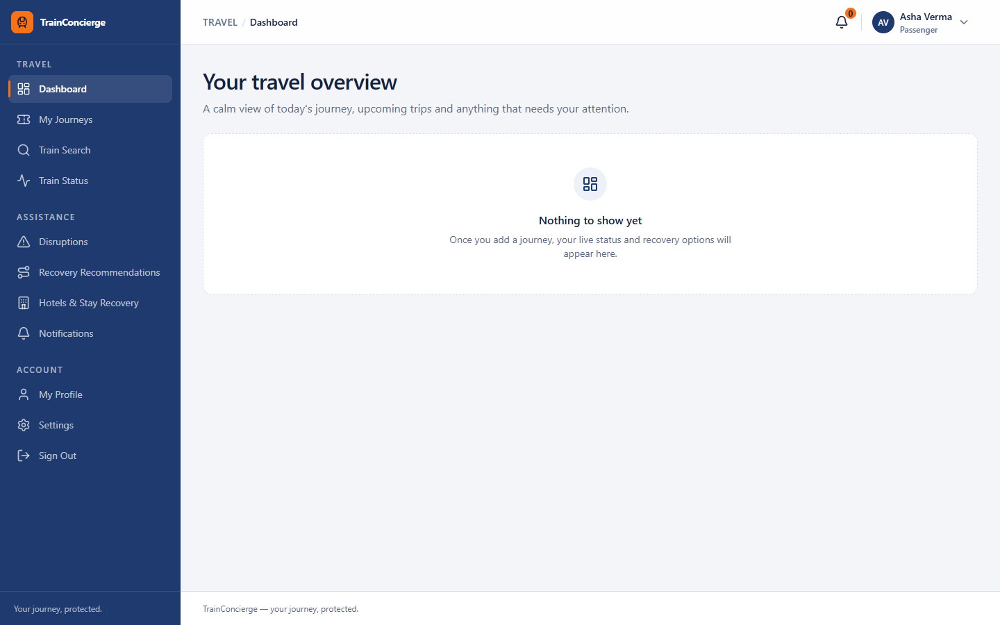
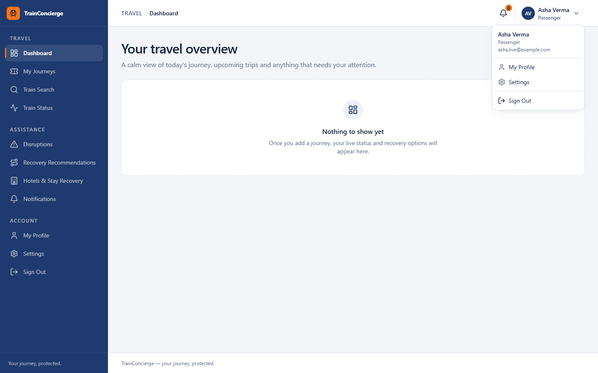
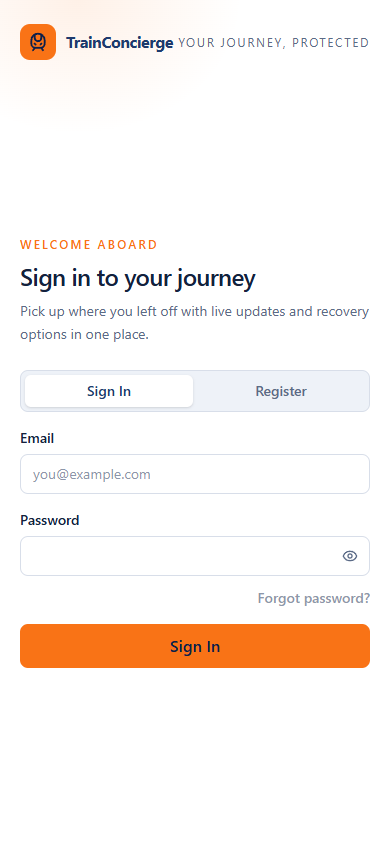
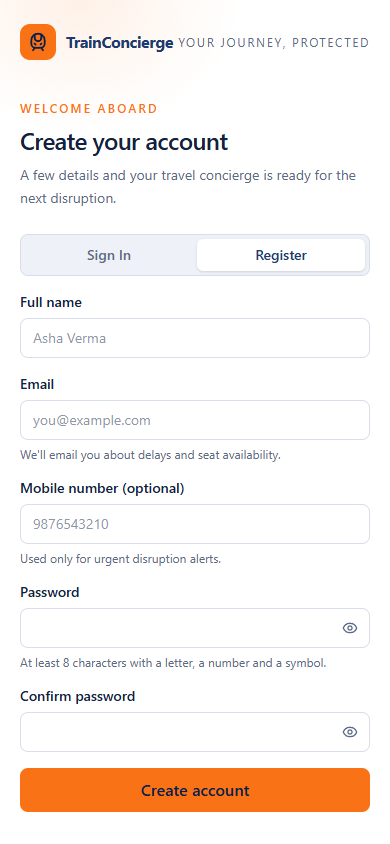

# Phase 04 — Auth Pages and Route Guards

- **Date:** 2026-10-27
- **Branch:** `master`
- **Status:** Complete. Sign In and Register are implemented against the real backend, the
  session is hydrated from `GET /auth/me`, every route is guarded, and sign-out clears the
  stored token, the query cache and registered SSE cleanups. `npm run test` passes with 83
  tests in 7 files and `npm run build` succeeds. Nothing was committed or pushed.

## 1. What was built

- **`/auth` page** — split hero layout with Sign In and Register tabs. `?tab=register` opens
  Register directly and tab switches update the query string.
- **Sign In** — email and password, password visibility toggle, orange CTA, and a disabled
  "Forgot password?" control with the tooltip "Not available in this version".
- **Register** — full name, email, optional 10-digit Indian mobile, password and confirmation.
  The email field carries the helper "We'll email you about delays and seat availability."
- **Validation** — React Hook Form + Zod; the password rule mirrors the backend (8–72
  characters, at least one letter, one number and one symbol). Server field errors are mapped
  back onto the matching inputs.
- **Feedback** — loading/disabled submit; a generic message for `401`; a wait message for
  `429`; a friendly network message; no endpoint paths, raw bodies or tokens in the UI.
- **Registration flow** — a successful registration shows an "Account created successfully"
  toast and returns to Sign In with the registered email prefilled. Registration never starts a
  session; the user signs in explicitly to continue.
- **Session** — `{status, user, token}` with `checking | authenticated | anonymous`,
  `sessionStorage` persistence, `fetchCurrentUser()` via `GET /auth/me`, and a single
  `signOut()` path.
- **API client** — one Axios instance with a bearer-token request interceptor, normalized
  errors and single-shot `401` handling.
- **Route guards** — anonymous redirects with a remembered target, role separation, access
  denied, expired-session handling, and `/` routing by role after the splash.
- **Account surfaces** — the header and profile menu show the full name and role; sign-out is
  available from both the profile menu and the sidebar.

No login is simulated anywhere: a session only exists after a successful `POST /auth/login`
or a valid stored token confirmed by `GET /auth/me`.

## 2. Routes and redirects

| Current state | Requested route | Result |
| --- | --- | --- |
| Anonymous | `/app/*` or `/admin/*` | `/auth`, with the attempted route kept in history state |
| Anonymous | `/auth` | Sign In page (Register with `?tab=register`) |
| Checking session | Guarded route | Session loading screen while `/auth/me` runs |
| Authenticated, same role | `/auth` after sign-in | Remembered route, including its query string |
| Authenticated, other role | `/auth` after sign-in | Role home (`PASSENGER` → `/app/dashboard`, `ADMIN` → `/admin/dashboard`) |
| Authenticated | `/auth` | Role home |
| Authenticated `PASSENGER` | `/admin/*` | Access denied page with "Go to dashboard" |
| Authenticated `ADMIN` | `/app/*` | `/admin/dashboard` |
| Authenticated | `/` | Splash (minimum hold, at most seven seconds), then role home |
| Anonymous | `/` | Splash, then `/auth` |
| Any | Unknown path | Not found page |
| Session rejected (`401`) | Any protected route | Session cleared, `/auth?reason=expired` with a banner |
| After registration | — | Success toast, then Sign In with the email prefilled; no session is created |
| Sign out | Any protected route | `/auth` (replace), token/cache/cleanups cleared |

The remembered target is only honoured when it belongs to the signed-in role; otherwise the
role home is used. A remembered `/admin/...` route never leaks to a passenger.

## 3. Session and API client

`src/lib/tokenStorage.ts` owns the `trainconcierge.token` key and the module-level
"session expired" flag. `src/lib/session.ts` validates the user shape returned by
`GET /auth/me` and discards a token that no longer resolves.

`src/app/SessionProvider.tsx` exposes `signIn`, `signOut`, `refreshSession` and
`abandonSession`. The provider starts in `checking` only when a token exists; otherwise it is
`anonymous` immediately. `refreshSession` is de-duplicated, so the splash and the guards can
both ask for the profile without sending duplicate requests. `signOut` captures the token,
starts the logout request, clears local state immediately, clears the TanStack Query cache,
runs every registered session cleanup and replaces the history entry with `/auth`; a failed
logout call is ignored because the local session is already gone.

`src/lib/apiClient.ts` is the only Axios instance:

- `VITE_API_BASE_URL` supplies the base URL (absolute or the Vite `/api` proxy).
- A request interceptor adds `Authorization: Bearer <token>` when a token is stored.
- Failures normalize to `{status, code, message, fieldErrors}`; messages are written for
  humans and never include the request URL or a raw response body.
- A `401` on any endpoint except login, register and logout clears the token, marks the
  session as expired and notifies the session provider once. The provider clears the cache and
  SSE cleanups but does not navigate; the guards perform the single redirect to
  `/auth?reason=expired`. This avoids competing navigations.
- There are no automatic retries, so a rejected token cannot cause a request loop.
- Typed helpers (`api.get<T>`, `api.post<T>`, `api.put<T>`, `api.patch<T>`, `api.delete<T>`)
  keep response types explicit.

The SSE cleanup registry (`src/lib/sessionCleanup.ts`) is empty in this phase; Phase 09 will
register live-update streams with it so sign-out and expiry close them.

## 4. Session storage trade-off

The JWT is kept in `sessionStorage`, not `localStorage` or a cookie:

- **Scoped to one tab.** Closing the tab ends the browser session; a second tab does not
  inherit the token. This matches the expected shared-device behaviour for a travel app.
- **No CSRF surface.** The token is attached explicitly by JavaScript rather than sent
  automatically by the browser.
- **XSS exposure.** Any script running on the origin can read `sessionStorage`. The app avoids
  `dangerouslySetInnerHTML`, renders user data through React's escaping, and never logs the
  token. A strict Content Security Policy and dependency hygiene remain important.
- **No persistence across restarts.** Users sign in again after closing the tab, which is
  acceptable for this version and keeps the attack window smaller than `localStorage`.

For production, the stronger option is an `HttpOnly`, `Secure`, `SameSite` cookie with a
refresh-token rotation flow plus CSRF protection, because JavaScript can never read it. That
requires backend changes (cookie issuance, refresh and CSRF endpoints) and is deliberately out
of scope for Phase 04. The token is a short-lived (60-minute default) bearer token, logout
revokes its `jti`, and the client clears it on any `401`.

## 5. Validation and error mapping

| Situation | What the user sees |
| --- | --- |
| Missing or invalid email / password | Inline field messages from Zod |
| Weak password or mismatch | The mirrored policy message and "Passwords do not match." |
| Invalid mobile number | Inline format message; the field stays optional |
| Wrong credentials (`401`) | "Incorrect email or password." |
| Duplicate email (`409 EMAIL_TAKEN`) | "An account with this email already exists." on the email field |
| Login throttled (`429`) | "Too many attempts. Please wait a few minutes and try again." |
| Server unreachable | "We could not reach the server. Check your connection and try again." |
| Validation rejected by the server (`400`) | "Please check the highlighted fields." plus mapped field errors |
| Expired session on a protected request | Redirect to `/auth?reason=expired` with "Your session has expired. Please sign in again to continue." |

## 6. Screenshots

Desktop (1440 × 900):















Mobile (390 × 844):





## 7. Verification

### Tests

`cd frontend && npm run test`:

```
Test Files  7 passed (7)
     Tests  83 passed (83)
```

Phase 04 coverage includes:

- `src/features/auth/__tests__/AuthPage.test.tsx` — 17 tests: default tab, direct Register URL,
  validation, `401`/`403`/`429`/network messages, passenger and admin destinations, remembered
  passenger route, ignored admin route for a passenger, password toggle, expired banner,
  registration validation, duplicate email mapping, the success toast, the return to Sign In and
  the remembered route when switching tabs.
- `src/app/__tests__/guards.test.tsx` — 9 tests: anonymous redirect with `state.from`, expired
  session reason, access denied for a passenger on `/admin`, admin redirected away from
  `/app`, authenticated users redirected away from `/auth` for both roles, and sign-out
  clearing the token, cache, cleanups and navigating to `/auth`.
- `src/lib/__tests__/apiClient.test.ts` — 5 tests: bearer header, single `401` handling with
  token clearing, login `401` not marked as an expired session, hidden `500` internals and a
  network error that does not expose the URL.
- `src/features/splash/__tests__/SplashScreen.test.tsx` and
  `src/app/__tests__/layouts.test.tsx` were updated for the real session shape and the guarded
  router.

The AuthPage router in the tests includes `RequireAnonymous`, so the guard and the page are
exercised together.

### Build

`cd frontend && npm run build` succeeded: `tsc -b` and `vite build`, 2314 modules, output
`index-CvUa-34C.js` 700.66 kB (224.48 kB gzip) and `index-DfbcaZiO.css` 45.70 kB. Vite warns
that the main chunk is over 500 kB; route-level code splitting is a later optimization and does
not affect correctness.

### Live verification

Run against the real Spring Boot API on an in-memory H2 database with the demo admin profile
and the Vite dev server. The local demo passwords used for the checks were supplied through
environment variables and command-line arguments only; no token or password was read, printed
or logged.

- Splash held, then opened `/auth` with no session.
- `/auth?tab=register` opened Register directly.
- Registering a passenger showed the "Account created successfully" toast and returned to Sign
  In with the email prefilled. Signing in with that account then opened `/app/dashboard`, and
  the header showed the full name and "Passenger".
- A full page reload restored the session through `GET /auth/me`.
- An anonymous visit to `/app/journeys` redirected to `/auth`; after signing in the app returned
  to `/app/journeys`.
- A passenger opening `/admin/dashboard` saw Access denied; "Go to dashboard" returned to
  `/app/dashboard`.
- The demo administrator signed in to `/admin/dashboard` and was redirected there from
  `/app/dashboard`.
- An invalid stored token on a protected route produced `/auth?reason=expired`, the banner, and
  a cleared token.
- Sidebar sign-out and the profile menu sign-out both returned to `/auth`; the menu shows the
  name, role, email, My Profile, Settings and Sign Out.
- "Forgot password?" remained disabled with its tooltip.

### Regression found and fixed during live verification

The first live pass showed a remembered route landing on `/app/dashboard` instead of
`/app/journeys`, although the redirect to `/auth` carried the correct history state. The cause
was a redirect race: `AuthPage` navigated to the remembered route, then `RequireAnonymous`
observed the newly authenticated session and replaced that navigation with the role home.

`RequireAnonymous` now resolves its destination with the same `resolvePostLoginTarget` helper
as the page: a same-role remembered route wins, otherwise the role home is used. Both redirects
therefore agree, and the full router test now includes `RequireAnonymous` to keep the two paths
from drifting apart again. The live flow then returned to `/app/journeys`.

### Follow-up: registration rejected on a second dev port

When port 5173 is occupied, Vite starts on 5174 instead. The registration `POST` was then
rejected with `403 Invalid CORS request` because the browser sent `Origin:
http://localhost:5174` while the backend allows only `APP_FRONTEND_ORIGIN` (5173 by default).
The auth page did not have a `403` case, so it fell back to "Something went wrong. Please try
again." and looked like a server failure even though the form was valid.

The dev proxy now removes the browser `Origin` header for `/api` requests. The browser already
treats `/api` as same-origin, and the proxy is development-only, so backend CORS still protects
real cross-origin calls. The auth error mapping also handles `403` explicitly with "You do not
have permission to do that." Registration was re-verified on port 5174, and the suite grew to
83 tests.

## 8. Security notes

- Tokens and passwords are never written to logs, rendered in the UI or included in error
  messages. The demo password is never shipped; it comes from `DEMO_PASSWORD`.
- The client never decides a role from decoded token contents; the profile from `/auth/me`
  drives the UI, and the backend enforces every request.
- Route guards are a UX boundary, not the security boundary: the API rejects unauthenticated
  and unauthorized requests regardless of what the browser renders.
- Server errors are normalized before display, so raw bodies, stack traces and internal paths
  never reach the user.
- "Forgot password?" is a disabled placeholder. There is no email reset flow in this version.

## 9. Known limitations

- No refresh-token flow: when the 60-minute token expires, the next protected request returns
  the user to `/auth` with the expired-session banner.
- Registration always creates a passenger; administrators still come only from the demo seed or
  the one-time provisioning profile.
- No "remember me": closing the tab ends the session by design.
- The SSE cleanup registry is ready but unused until live updates arrive in Phase 09.
- The main JS chunk exceeds Vite's 500 kB warning threshold; no functional impact.

## 10. Key files

| Area | Path |
| --- | --- |
| Auth page and schemas | `frontend/src/features/auth/AuthPage.tsx`, `schemas.ts`, `errors.ts`, `api.ts` |
| Access denied | `frontend/src/features/auth/AccessDeniedPage.tsx` |
| Session | `frontend/src/app/SessionProvider.tsx`, `frontend/src/lib/session.ts`, `tokenStorage.ts` |
| API client | `frontend/src/lib/apiClient.ts` |
| Navigation helpers | `frontend/src/lib/navigation.ts`, `sessionCleanup.ts` |
| Guards and router | `frontend/src/app/guards.tsx`, `router.tsx` |
| Layouts | `frontend/src/layouts/AuthLayout.tsx`, `AppShell.tsx`, `ProfileMenu.tsx` |
| Shared input | `frontend/src/components/ui/input.tsx` (trailing slot for the password toggle) |
