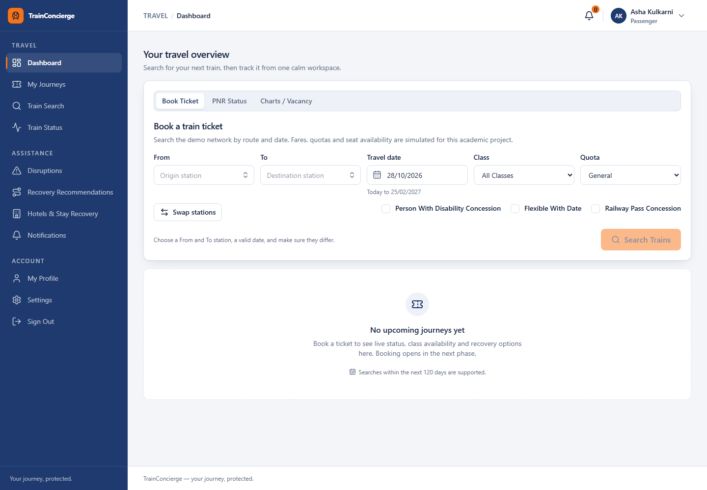
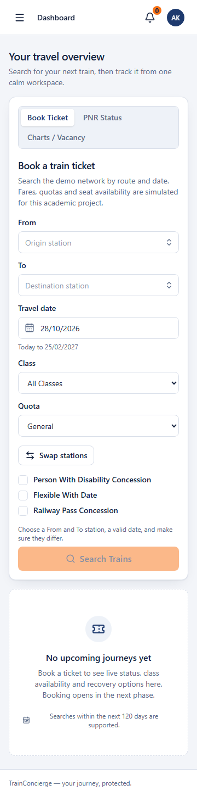
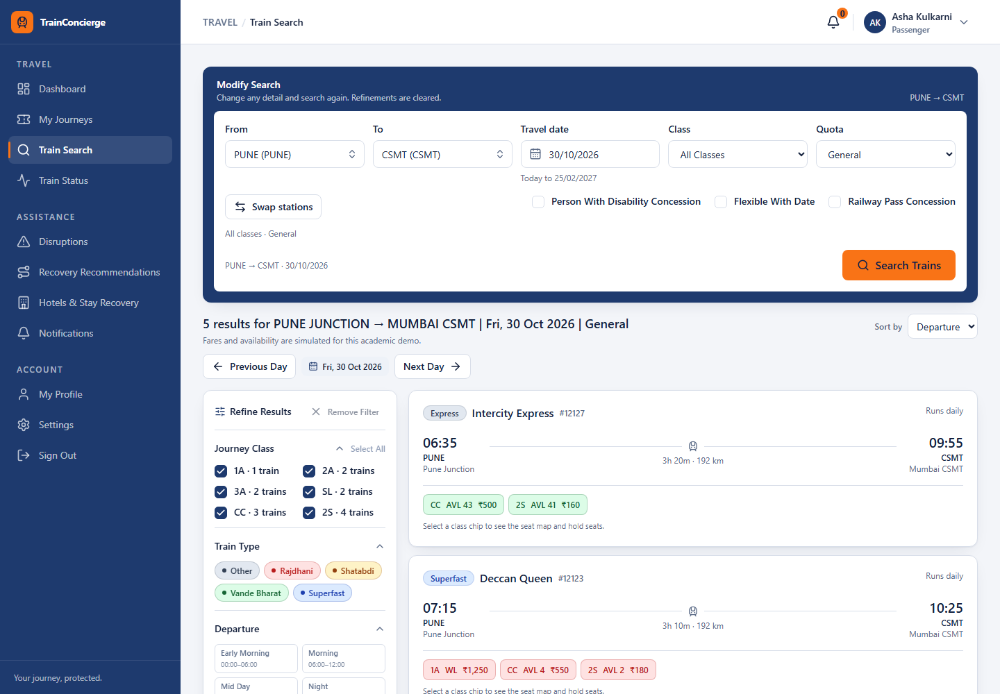
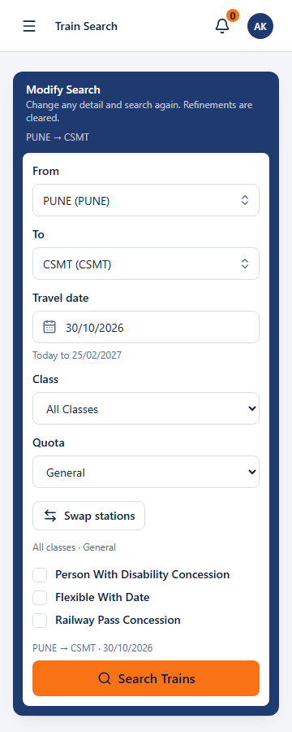
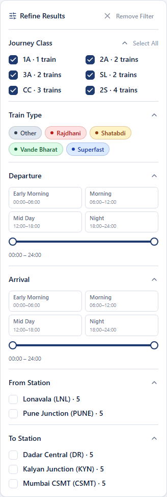
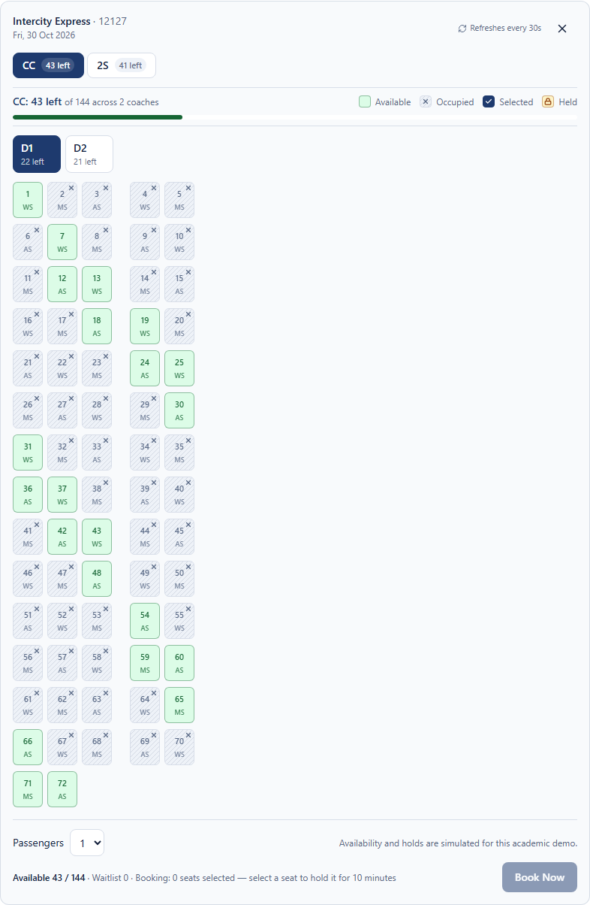
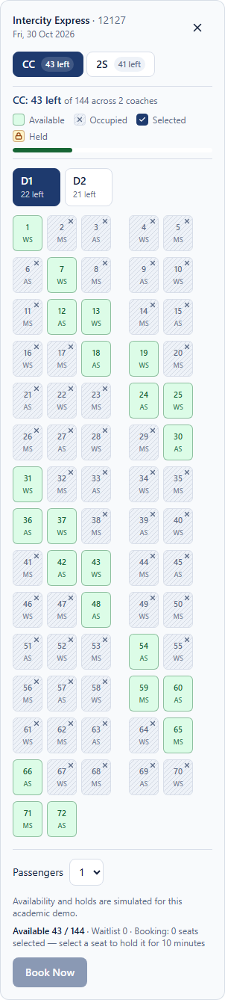
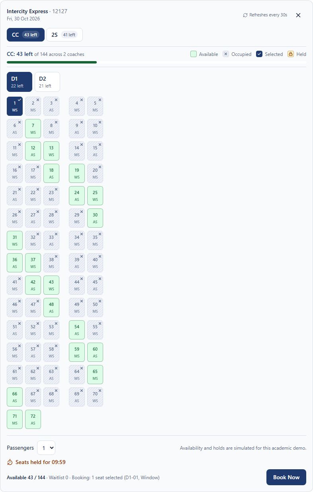
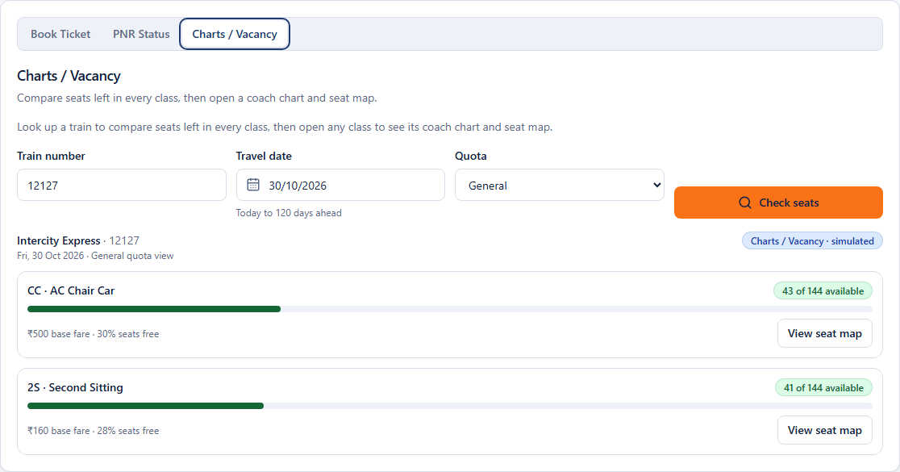
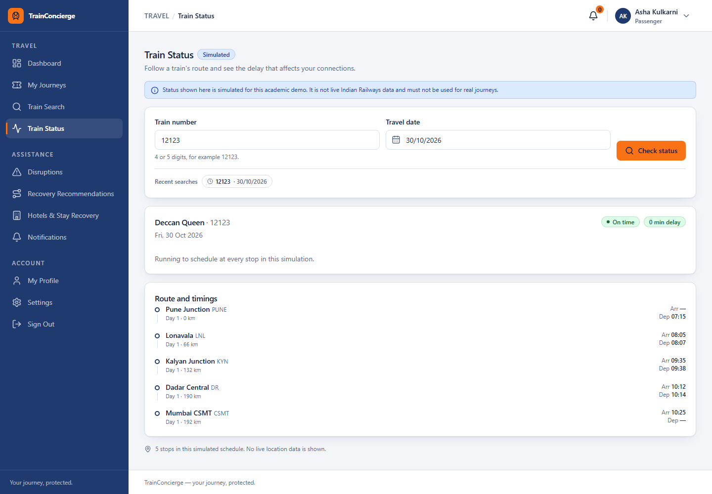

# Phase 06 — Train Search and Seat Map

- **Date:** 2026-10-28
- **Branch:** n/a (the workspace is not a Git repository)
- **Status:** Complete. Train search, availability, coach and seat maps, seat holds, Charts /
  Vacancy, and the Train Status page are implemented and verified. `mvn clean verify` passes
  with 54 tests, `npm run build` passes and `npm run test` passes with 95 tests. Live checks on
  an isolated `local-h2,demo` backend confirmed five Pune → CSMT results, matching class and
  coach counts, a simulated status, and one-winner/one-409 seat-hold concurrency. Screenshots
  were regenerated at 1440 px and 360 px, and every checked page had no horizontal page scroll
  at 360 px. Nothing was committed or pushed.

## 1. What was built

**Backend**

- `TrainTravelController` — search, per-class availability, coach lists, seat maps and train
  status under `/api/trains/**`.
- `TrainSearchService` — stop-order matching (including intermediate stations), station areas,
  class/type/time/from/to-station filters, sorting, segment fares and quota simulation.
- `TrainSeatService` and `SeatInventoryService` — class, coach and seat counts that all read the
  same `seat_inventory` rows, plus per-class summaries.
- `SeatHoldService` and `SeatHoldController` — `POST /api/seat-holds`,
  `DELETE /api/seat-holds/{id}` and `GET /api/seat-holds/mine`, with JWT ownership, optimistic
  locking and `409 SEAT_UNAVAILABLE`.
- `SeatHoldExpiryJob` — releases expired holds every minute; expired rows are also released
  before holding or listing seats.
- `SeatAlertService` with `NoOpSeatAlertService` — called after every successful search; Phase 09
  replaces the no-op implementation. No email is sent in this phase.
- `V4__seat_holds_and_search_settings.sql` — adds `seat_inventory.held_by`, its index and
  foreign key, and the `seat_alert_threshold`, `seat_very_low_threshold`,
  `seat_hold_minutes` and `station_group_radius_km` settings.

**Frontend**

- A reusable travel module with `BookTicketCard`, `SearchForm`, `StationCombobox`, `DateField`,
  `PnrStatusPanel`, `ChartsVacancyPanel`, `ModifySearchBar`, `FiltersPanel`, `TrainCard`,
  `SeatSelectionPanel`, `SeatMap`, `ClassTabs`, `CoachSelector` and `SeatLegend`.
- Three ticket tabs: **Book Ticket**, **PNR Status** and **Charts / Vacancy**. PNR lookup is the
  Phase 07 placeholder; Charts / Vacancy shows per-class bars and a **View seat map** action.
- `/app/search` results with URL-as-state filters, sort, previous/next day and a friendly
  zero-results state.
- `/app/status` with a simulated status badge, delay, ordered stops and disruption link when one
  exists.
- Tests for card validation, swap, From ≠ To, tabs, URL filter sync, zero results, seat
  selection limits, keyboard operation, the availability bar and the booking summary.

### Alignment fixes in this pass

The first cut was functionally complete but differed from the brief in a few UI details. This
pass corrected them:

- Four tabs became the required three: the standalone **Vacancy** tab was merged into
  **Charts / Vacancy**. The tab strip wraps at 360 px instead of clipping.
- Time buckets now read **Early Morning**, **Morning**, **Mid Day** and **Night**, each with its
  `00:00–06:00` range in a two-column button grid above the dual slider.
- Journey Class is a checkbox grid with train counts (`3A · 2 trains`) and **Select All**,
  replacing availability buttons.
- Train Type chips are tone-coloured and show a dot, a check and a navy ring when selected.
- The seat panel now shows the brief's thin availability bar and the summary
  `Available 43 / 144 · Waitlist 0 · Booking: 1 seat selected (D1-01, Window)`.
- Tests were updated for the checkbox roles, tab names, bucket filter, keyboard hold, progress
  bar and summary.

## 2. Search behaviour

`GET /api/trains/search` accepts:

| Parameter | Behaviour |
| --- | --- |
| `from`, `to` | Required station codes, trimmed and uppercased; they must differ |
| `date` | Required; today to 120 days ahead |
| `class` | CSV of class codes; keeps trains that offer every requested class |
| `quota` | `GENERAL`, `TATKAL`, `LADIES`, `SENIOR_CITIZEN`, `PREMIUM_TATKAL` |
| `types` | CSV of train types |
| `depFrom`, `depTo`, `arrFrom`, `arrTo` | Minutes from midnight; windows swap if reversed |
| `fromStations`, `toStations` | CSV of specific boarding or alighting stations |
| `sort` | `DEPARTURE` (default), `ARRIVAL`, `DURATION`, `FARE` |

Key rules:

- Matching uses `train_schedule.stop_order`: a train qualifies when a boarding stop precedes an
  alighting stop, so through trains and intermediate-station pairs work, not only origin to
  destination trains.
- Stations within `station_group_radius_km` (default 60) form the origin and destination areas,
  which is how nearby stations such as Pune and Khadki or CSMT, Dadar and Kalyan appear as
  options.
- Segment fares scale the class base fare by the travelled distance and round to the nearest ₹5.
- Quota changes displayed availability and fare only: Tatkal 25% of seats at 1.30×, Premium
  Tatkal 10% at 1.50×, Ladies 40% at the base fare, Senior Citizen and General 100% at the base
  fare. The UI labels this as a simulation and never claims real Tatkal rules.
- Availability levels come from settings: above `seat_alert_threshold` (20) is `PLENTY`, 6–20
  is `LOW`, 1–5 is `VERY_LOW`, and 0 is `WAITLIST`.
- Each item carries `trainNumber`, `trainName`, `type`, from/to codes and times with
  `dayOffset`, `durationMinutes`, `distanceKm`, `runsOn` and per-class
  `code`, `fare`, `baseFare`, `available`, `total`, `label` and `level`.

Bad input returns the shared `ApiError` shape: `400` for validation, `401` without a token,
`404` for unknown stations or trains. A search with no matches returns `200` with an empty
`results` array; the UI shows the zero-results state instead of a blank page.

## 3. Availability, seat maps and holds

- `GET /availability` and `GET /coaches` read the same `seat_inventory` rows as
  `GET /seats`, so class, coach and seat counts agree. Live check: 12127 CC showed 43 available
  of 144, and its two coaches showed 22 + 21.
- Coach layouts are `BERTH` (bays of six plus two side berths) and `CHAIR_2x2`, `CHAIR_3x2`,
  `CHAIR_2x1` with an aisle gap.
- Each seat is a `button` labelled `Seat 12, Lower berth, available`, with
  `aria-pressed` when selected. Occupied and held seats are disabled; colour is always paired
  with an icon, pattern and legend text.
- The passenger selector accepts 1–6. Selecting more seats than the count is blocked with an
  explanatory message; reducing the count releases the extra holds.
- Selecting a seat calls `POST /api/seat-holds`; deselecting calls
  `DELETE /api/seat-holds/{id}`. Holds show `Seats held for 09:59` and expire after
  `seat_hold_minutes` (10). On expiry the UI releases the selection and says so.
- The map and counts refetch every 30 seconds while the panel is open. Live updates through SSE
  arrive in Phase 09.
- Concurrency uses the `version` column. The live check held 12127/D1/seat 1 as one passenger
  (`201`), attempted the same seat as another (`409 SEAT_UNAVAILABLE`), then released the first
  hold (`204`).
- Mobile keeps the page width fixed; the seat grid scrolls horizontally inside its own
  container.

## 4. Screenshots

Captured with headless Chrome against an isolated backend on port 8082 (in-memory H2,
`local-h2,demo`) and Vite on port 5176, using the demo passenger
`asha.kulkarni@trainconcierge.demo`. Travel date for results and seat maps: 2026-10-30.

**Book Ticket card**

**Results and filters**

**Seat map and hold**

**Charts / Vacancy and Train Status**

## 5. Acceptance criteria

| Criterion | Result |
| --- | --- |
| Pune → Mumbai on the demo date returns at least 5 results | **Pass.** 2026-10-30 returned 5: 12127, 12123, 12125, 11007 and 12169. Sunday 2026-11-01 returns 4 because 12169 does not run that day; search still never returns an empty page for this corridor. |
| Each filter changes the result list and filters survive a refresh through the URL | **Pass.** Class, train type, departure bucket and sort tests assert the API call and the query string; `readRouteSearch` restores every filter on reload. |
| Swap, date limits and From ≠ To validation work | **Pass.** Frontend tests cover swap, a past date and identical stations; the API rejects same-station and out-of-window dates with `400`. |
| Seat map renders berth and chair layouts, distinguishes occupied, available, held and selected, and works by keyboard | **Pass.** `SeatMap` layout tests cover berth bays and chair rows; a keyboard test focuses a seat and presses Enter to hold it. The legend and ARIA labels are asserted. |
| Two browsers cannot hold the same seat | **Pass.** Backend optimistic-locking test plus a live two-passenger check: first hold `201`, second `409 SEAT_UNAVAILABLE`. |
| Holds expire and release | **Pass.** `SeatHoldExpiryJob` test releases an expired row; the UI clears the hold and shows the expiry message. |
| Charts / Vacancy bars match the seat map counts exactly | **Pass.** Live 12127 CC 43 of 144 = coaches D1 22 + D2 21; 2S 41 = F1 20 + F2 21. Both views read the same inventory. |
| No horizontal page scroll at 360 px | **Pass.** Measured `scrollWidth === clientWidth` (360) on `/app/dashboard`, `/app/search`, `/app/status`, and with a seat map open. The seat grid scrolls inside its own container. |
| `mvn clean verify`, `npm run build`, `npm run test` pass | **Pass.** 54 backend tests, production build succeeds, 95 frontend tests. |

## 6. Live verification

Backend on port 8082 with `local-h2,demo`, an in-memory H2 database in MySQL mode and a locally
supplied `DEMO_PASSWORD`; the password and token are not recorded here. Startup logged the demo
catalog and six demo accounts.

| Check | Result |
| --- | --- |
| `GET /api/trains/search` without a token | `401` |
| `GET /api/trains/search?from=PUNE&to=CSMT&date=2026-10-30` | `200`, 5 results: 12127, 12123, 12125, 11007, 12169 |
| 12127 classes | CC 43/144 `PLENTY`, 2S 41/144 `PLENTY` |
| 12123 classes | 1A 0/48 `WAITLIST`, CC 4/144 and 2S 2/144 `VERY_LOW` |
| 11007 classes | 2A 28/96, 3A 40/128, SL 43/144, 2S 44/144, all `PLENTY` |
| `GET /api/trains/12127/availability?date=2026-10-30` | CC `AVL 43`, 2S `AVL 41` |
| `GET /api/trains/12127/coaches?...&class=CC` | D1 22/72 and D2 21/72 |
| `GET /api/trains/12127/coaches?...&class=2S` | F1 20/72 and F2 21/72 |
| `GET /api/trains/12123/status?date=2026-10-30` | `ON_TIME`, 0 minutes, 5 stops, `simulated=true` |
| Hold 12127/D1/1 as passenger A | `201` |
| Hold the same seat as passenger B | `409 SEAT_UNAVAILABLE` |
| Release passenger A's hold | `204` |

Failure modes use the shared `ApiError` shape; no stack trace or seat owner is exposed.

## 7. Tests and build

**Backend — `mvn clean verify`:** 54 tests, 0 failures, 0 errors, 0 skipped, BUILD SUCCESS
(11 test classes). `TravelApiTest` adds 16 tests:

- Search requires authentication; Pune → Mumbai works through stop order.
- Intermediate boarding and alighting stations are matched.
- Class, type and departure/arrival time filters narrow results.
- Fare, duration and arrival sorting.
- Quota simulation changes availability and fare only.
- A zero-result search is an empty list, not an error.
- Past dates, identical stations and dates beyond the window are rejected.
- Availability, coach and seat-map counts agree.
- Berth coaches expose lower, middle, upper and side berths.
- Hold, release and ownership follow the API contract.
- Expired holds are released by the scheduled job.
- Stale seat writes fail with optimistic locking.
- Train status is simulated and defaults to `ON_TIME`.

**Frontend — `npm run build && npm run test`:** the type-check and Vite production build pass
(2,338 modules; 783.98 kB JavaScript, 245.97 kB gzip). Vite warns that the main chunk exceeds
500 kB; it is a warning, not a failure. Vitest runs **95 tests in 10 files, all passing**. The
Phase 06 files are:

- `BookTicketCard.test.tsx` — default date, disabled search, URL navigation, three tabs,
  Charts / Vacancy panel, same-station block, swap and past-date validation.
- `TrainSearchPage.test.tsx` — result header, type/class filters with URL sync, departure
  bucket with `depFrom`/`depTo`, sort persisted in the URL, Remove Filter and the zero-results
  date shift.
- `SeatSelectionPanel.test.tsx` — legend and ARIA states, hold creation, passenger limit,
  Book Now feedback, availability bar, booking summary and keyboard hold.
- `SeatMap` layout tests — berth bays with side berths, and chair rows with window, middle and
  aisle seats.

## 8. Limitations and follow-ups

- **No live seat updates yet.** The map refetches every 30 seconds; SSE arrives in Phase 09.
- **Book Now does not create a booking.** It saves the held selection and states that booking,
  fares and payment arrive in Phase 07.
- **PNR lookup is a placeholder.** The 10-digit input and Phase 07 notice are present; no PNR
  data is fetched.
- **Train status is simulated.** It defaults to `ON_TIME`; admin-driven delays and cancellations
  arrive in Phase 08. The page never claims live Indian Railways data.
- **Quota rules are simulated.** They change displayed seats and fares only.
- **MySQL/Flyway for V4 is not verified live.** The checks ran on H2 in MySQL mode with Flyway
  disabled, consistent with the Phase 05 limitation. Run the migration against a throwaway MySQL
  schema before a shared deployment.
- **Sunday has four Pune → Mumbai trains.** The five-result guarantee holds on the demo date
  tested; the corridor is never empty, but 12169 does not run on Sundays in the demo data.
- **Screenshots use an isolated instance.** The existing app on ports 8080/5173 was left
  untouched; the capture run used in-memory H2 on 8082 and Vite on 5176, so no demo rows or
  holds were written to the local persistent database.

## 9. Files

Created:

- `backend/src/main/java/com/trainconcierge/travel/` — controller, search, seat, hold, settings
  and alert services, expiry job, enums, repositories, `dto/` and `BerthTypes`
- `backend/src/main/resources/db/migration/V4__seat_holds_and_search_settings.sql`
- `backend/src/test/java/com/trainconcierge/travel/TravelApiTest.java`
- `frontend/src/features/travel/` — `api.ts`, `constants.ts`, `date.ts`, `searchParams.ts`,
  `types.ts`, `components/` and `__tests__/`
- `frontend/src/features/passenger/pages/TrainSearchPage.tsx`
- `frontend/src/features/passenger/pages/TrainStatusPage.tsx`

Modified:

- `frontend/src/app/router.tsx` — `/app/search` and `/app/status` routes.
- `frontend/src/features/passenger/pages/DashboardPage.tsx` — Book Ticket card.
- `frontend/src/features/travel/components/BookTicketCard.tsx` — three tabs and wrapping tab
  strip.
- `frontend/src/features/travel/components/FiltersPanel.tsx` — bucket grid, class checkboxes,
  tone-coloured type chips.
- `frontend/src/features/travel/components/SeatSelectionPanel.tsx` — availability bar and
  booking summary.
- `frontend/src/features/travel/components/ChartsVacancyPanel.tsx` — unified Charts / Vacancy
  panel.
- `frontend/src/features/travel/constants.ts` — bucket labels/ranges and shared level colours.
- `README.md` — Phase 06 state, schema version, travel API, travel routes, test counts and
  report link.
- `docs/reports/assets/phase-06-*.png` — 12 regenerated screenshots.

Not committed or pushed.
